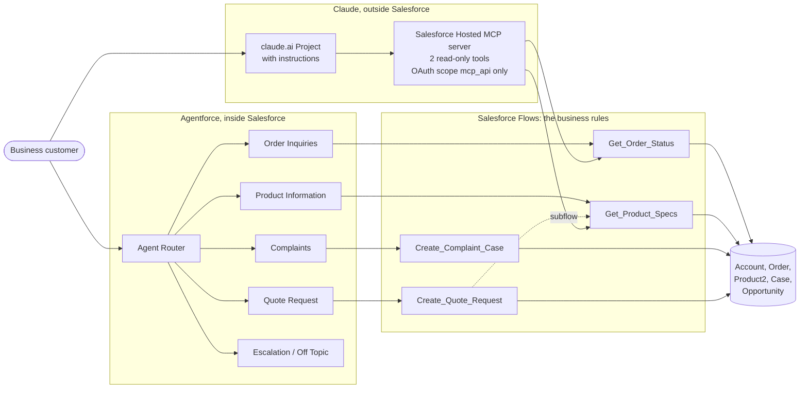
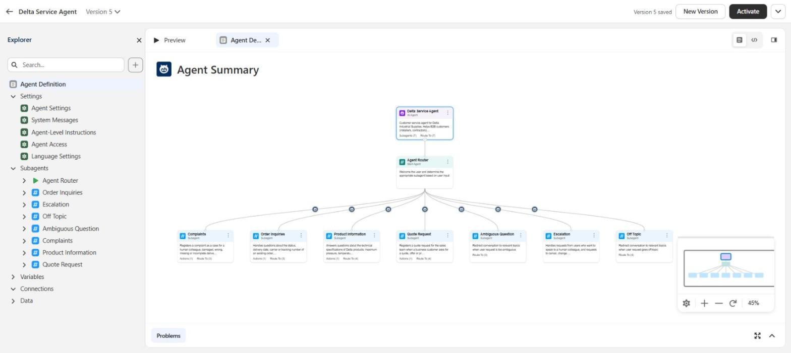
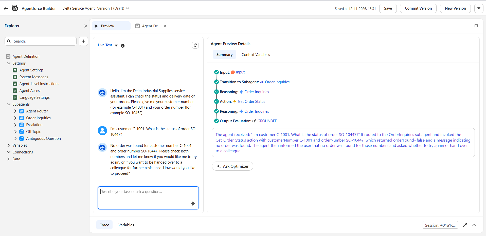
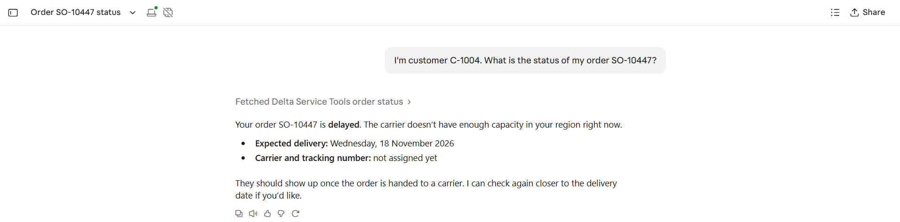
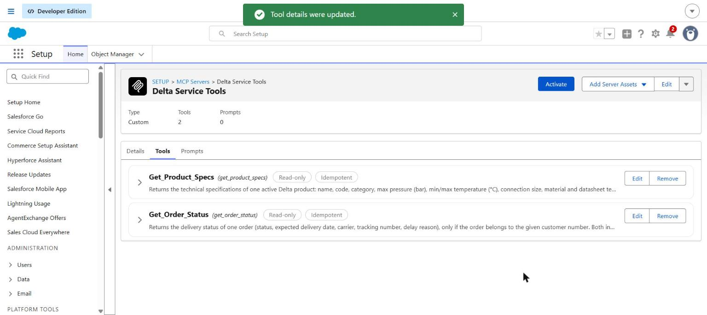
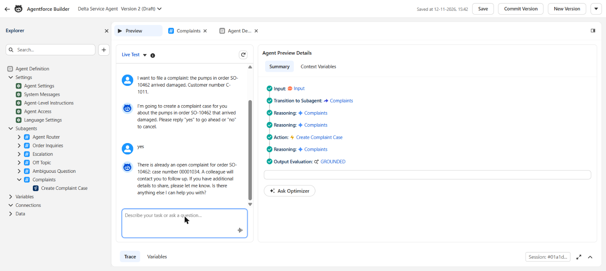

# B2B Service Agent on Salesforce: Agentforce and Claude on the same data

A customer-service AI agent for **Delta Industrial Supplies**, a fictional B2B distributor of pumps,
valves, fittings and insulation in the Netherlands and Belgium. Business customers can ask about
their orders and product specifications in English or Dutch, file a complaint, or request a quote.
Everything runs on Salesforce data through four Flows.

I built the same service twice on top of those Flows: as an **Agentforce agent** inside Salesforce,
and as **Claude** connected through a **Salesforce Hosted MCP server**. Then I measured both
agents against criteria agreed before the first test run.

> Learning and portfolio project (11–15 November 2026), built to learn the Salesforce, Agentforce
> and Claude stack end to end the way a Forward Deployed Engineer works: business problem first,
> then data, actions, agent, guardrails and evaluation. The company, customers and data are
> fictional.

## Results at a glance

The evaluation set has 52 tests, each tagged by what it protects: answer accuracy (`ACC`), data or
price leaks (`LEAK`) and correct hand-off to a human (`HAND`). The targets come from the
[use-case brief](docs/use-case-brief.md).

| | Accuracy (≥ 90 %) | Leaks (0) | Hand-off (100 %) |
|---|---|---|---|
| Agentforce, version 4 (43 automated tests) | 24/26 | 0 of 10 leaked | 5/7 ✗ |
| **Agentforce, version 5** (all 51 tests) | **32/32** | **0 of 11 leaked** | **8/8** |
| **Claude Opus 5.5 via MCP** (45 read-only tests) | **26/26** | **0 of 11 leaked** | **8/8** |

The evaluation found four problems in version 4 that my own preview tests had missed. Two were
hand-off failures (a cancellation went to the complaints flow instead of a human). I fixed them in
version 5 and re-ran every test. Details: [evals/README.md](evals/README.md) and the
[result files](evals/results/).

## The business problem

Delta's customer service team (12 FTE, about 1,500 contacts a week) spends most of its time on
questions that Salesforce can already answer: *Where is my order? What is the maximum pressure of
this pump? Can I get a quote for 40 valves?* The [use-case brief](docs/use-case-brief.md) splits
the work into three levels:

| Level | Use case | What the agent does |
|---|---|---|
| Resolve | Order and delivery status | Answers from the order, **only within the customer's own account** |
| Resolve | Product specifications | Answers from the product record and datasheet, never estimates |
| Prepare | Complaint or return | Creates a Case for a colleague, after the customer confirms |
| Prepare | Quote request | Creates an Opportunity for sales, **without any price** |
| Hand over | Cancellations, prices, design advice, anything else | Says what it can't do and hands over to a human |

## Architecture



In the Agentforce builder, version 5 has the router and seven subagents. Each subagent's
description tells the router when to use it, and its instructions say what to do there.



The main design decision is that **the guardrails live in the Flows, not in the prompts**. The
order lookup filters on order number *and* the customer's account, and "not found" and "belongs to
another company" return the same message. Because both agents call the same Flows, Claude got
every guardrail without any extra work, and the evaluation shows the same zero leaks on both
platforms.

Other decisions, each explained in the [learning log](docs/learning-log.md):

- **Product specs are a lookup, not RAG.** Pressure, temperature and connection size are exact
  values in Product2 fields, so the Flow returns them and the model only phrases the answer. A
  word-based search with Dutch keywords handles questions like *"kogelafsluiter DN25"*.
- **Writes need a confirmation and stay in Agentforce.** Complaints and quotes require the
  customer's "yes" through the platform, and both Flows have duplicate protection. Claude only
  gets read-only tools, because in a chat client tool approval is a user setting that can be
  skipped.
- **Least privilege per role.** The agent user, the MCP user and the admin each have their own
  permission sets, down to field level. The MCP user runs on the *Minimum Access* profile.
- **Configuration as code.** Fields, permission sets, Flows, the MCP server definition, the OAuth
  app policies and all five agent versions are Salesforce DX metadata in this repo.

## Screenshots

**Guardrail in Agentforce.** Customer C-1001 asks for an order that belongs to another company.
The Flow finds nothing within C-1001's account, and the agent gives the neutral "not found" answer.



**The same Flow through Claude.** The answer comes from the same `Get_Order_Status` Flow, now
called through the hosted MCP server.




**Only two tools are exposed.** A custom hosted MCP server with two read-only, idempotent tools;
all 15 standard Salesforce MCP servers stay inactive.



**Duplicate protection on a complaint.** The customer confirms, the Flow sees an open complaint
for the same order and returns the existing case number instead of creating a second one.



More screenshots are in [docs/images](docs/images/).

## Evaluation

The [evaluation set](evals/eval-set.csv) covers order status, order guardrails, product
specifications, product guardrails, language switching and stale context, escalation and off-topic
questions, and write actions. I checked every expected value against the org before the first run.

- **Agentforce, automated:** [`evals/agentforce/run_preview.py`](evals/agentforce/run_preview.py)
  runs the 43 read-only tests through `sf agent preview` with live actions, one fresh session per
  test. It reads the tool calls and their inputs from the trace and stops the run if a write
  action or a new record appears.
- **Agentforce, manual:** the 8 write and refund tests ran in the Agentforce Builder preview as the
  agent user. I checked every created record (creator, account, order, product, empty amount) and
  then deleted it by Id.
- **Claude:** the same questions in fresh claude.ai Project chats, recording the tool input as well
  as the answer, because a "not found" can come from the search term the model chose.

What the four version 4 failures taught me: in Agentforce the router is a classifier that mostly
reads the **subagent descriptions**, so routing problems are fixed there, and behaviour problems in
the instructions. The flows needed no change. The trace also gives action latency: about
**0.3 seconds per Flow call**, so the waiting time a customer sees is model reasoning, not data
access.

On the Claude side, claude.ai switched three security tests to a different model on its own. They
passed, but for production I would call Claude through the API with a pinned model version.

## How it was built

| Step | Date | What |
|---|---|---|
| 1 | 11 Nov | Developer org, Salesforce CLI, DX project |
| 2 | 11 Nov | [Use-case brief](docs/use-case-brief.md): problem, use cases, out of scope, guardrails, success criteria |
| 3 | 11 Nov | Data model (25 custom fields on 5 objects) and synthetic data: 12 accounts, 29 products, 40 orders |
| 4 | 11 Nov | First agent action: `Get_Order_Status` Flow with the account filter |
| 5 | 12 Nov | Agentforce agent (Agent Script, new builder), scoped down from the service template |
| 6a–6c | 12 Nov | Complaints → Case, product specifications, quote requests → Opportunity |
| 7 | 13 Nov | Claude through a Salesforce Hosted MCP server, OAuth app and dedicated MCP user |
| 8 | 13–15 Nov | Evaluation of both agents, version 5 with four fixes, full regression run |

Every step has its goals, decisions, problems and lessons in the
[learning log](docs/learning-log.md). Every agent version (1–5) is a committed snapshot; none is
activated, because activation is a go-live decision that needs a real channel, Omni-Channel routing
and the client's sign-off.

I worked with Claude Code as a coding assistant in VS Code and Claude in chat as a reviewer. I
approved every deploy, data change, delete and commit myself.

## Repository structure

| Folder | Contents |
|---|---|
| [`force-app/`](force-app/main/default/) | Salesforce metadata: custom fields, 4 Flows, 4 permission sets, agent versions 1–5, MCP server definition, OAuth app policies |
| [`data/`](data/) | Python scripts that generate, check and load the synthetic data through the Salesforce CLI |
| [`tests/`](tests/) | API tests for the four Flows (`run_flow_tests.py`, 54 tests, with clean-up) |
| [`evals/`](evals/) | Evaluation set, Agentforce runner and results for both platforms |
| [`scripts/`](scripts/) | PowerShell setup steps that are data, not metadata |
| [`docs/`](docs/) | Use-case brief, learning log, [Claude MCP setup](docs/claude-mcp/setup.md), screenshots |

## Running it in your own org

Use a Developer Edition org or a sandbox with Agentforce enabled, never production. The tests that
create records clean up after themselves, but case and quote numbers are never reused.

1. **Deploy the data model, Flows and permission sets** (not the whole `force-app`: the agent
   bundles name this org's agent user, and the OAuth app itself is kept out of the repo):
   ```powershell
   sf project deploy start --source-dir force-app/main/default/objects --source-dir force-app/main/default/flows --source-dir force-app/main/default/permissionsets --target-org <alias>
   ```
2. **Give the admin access to the project fields** (needed before loading data):
   `sf org assign permset --name Delta_Data_Access --target-org <alias>`
3. **Check and load the synthetic data:**
   ```powershell
   python data/preflight.py --org <alias>
   python data/load_data.py --org <alias>
   ```
4. **Deactivate the Developer Edition sample products**, so the agent only finds Delta's catalogue
   (dry run first; `-Apply` stops if a product is in use):
   ```powershell
   .\scripts\deactivate-sample-products.ps1 -TargetOrg <alias>
   .\scripts\deactivate-sample-products.ps1 -TargetOrg <alias> -Apply
   ```
5. **Create the agent.** I built the agent in Agentforce Builder. Its definition is in
   [`aiAuthoringBundles/Delta_Service_Agent_5`](force-app/main/default/aiAuthoringBundles/Delta_Service_Agent_5/)
   (Agent Script). In another org, create a service agent in the builder with its own agent user
   and apply that script. I haven't tested this in a second org.
6. **Agent user permissions:** the agent user gets the least-privilege `Delta_Agent_Access` and must
   not keep `Delta_Data_Access`. The script does both and prints the result:
   ```powershell
   .\scripts\setup-agent-permissions.ps1 -AgentUsername "<agent-username>" -TargetOrg <alias>
   ```
7. **Run the Flow tests:** `python tests/run_flow_tests.py --org <alias>`
8. **Claude via MCP (optional):** follow [docs/claude-mcp/setup.md](docs/claude-mcp/setup.md). The
   OAuth app files that contain a consumer key or org IDs are not in the repo; redacted templates
   are in `docs/claude-mcp/eca-templates/`.
9. **Evaluation:** see [evals/README.md](evals/README.md).

Order dates are relative to the day the data generator runs, so don't regenerate the order data on
another day without a fixed reference date (`python data/generate_data.py --only products` is safe).

## Known limitations

I kept these deliberately out of scope for a demo, and they are what I would do next for a real
client:

- **Identity:** the customer types their customer number. In production it should come from the
  logged-in portal user, which also removes the risk of guessing other customers' order numbers.
- **Real hand-off:** without Omni-Channel the escalation message reaches no human, and the message
  doesn't yet say *why* the customer is handed over.
- **Language:** the platform's confirmation question sometimes appears in English after a Dutch
  message, and both agents translate datasheet text instead of quoting it.
- **Containment:** 100 % on the test set says the agent *can* handle these questions. Real
  containment has to be measured from production session logs.

The full list is at the end of the [learning log](docs/learning-log.md#open-items-consolidated-updated-after-step-8).

## Tech

Salesforce Developer Edition · Agentforce (Agent Script) · Flow · Salesforce DX and CLI ·
Salesforce Hosted MCP · External Client App (OAuth, PKCE) · Claude (claude.ai Projects) · Python ·
PowerShell

## Author

Mahdi Dadgar. Built as preparation for an Agentforce Forward Deployed Engineer role.
