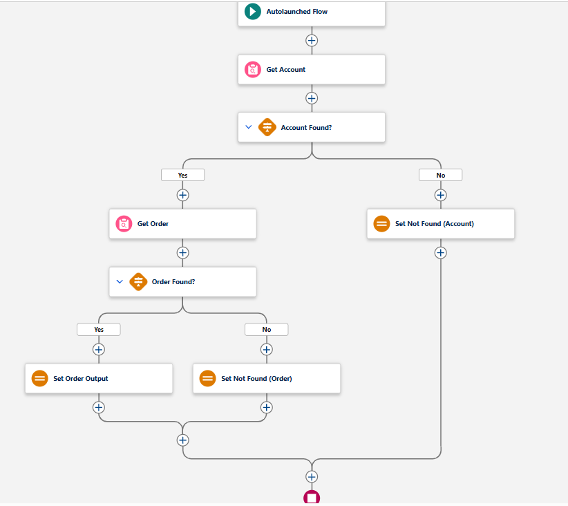
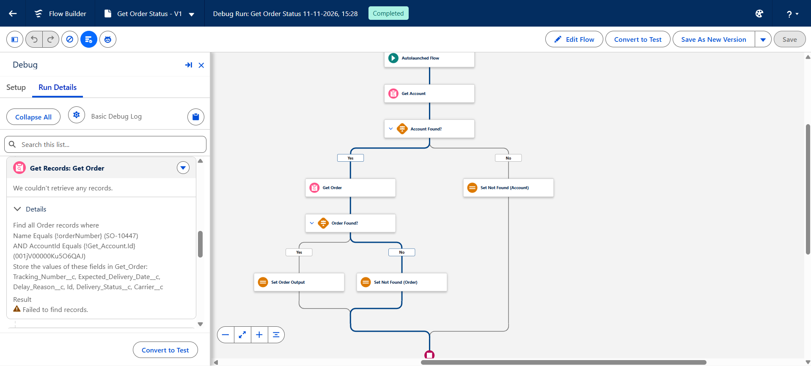

# B2B Service Agent on Salesforce (Agentforce + Claude)

An AI customer-service agent for **Delta Industrial Supplies**, a fictional B2B supplier of
industrial parts and building materials. The agent answers order-status and product
questions, takes quote requests and logs complaints in Salesforce, with guardrails, an
evaluation set and monitoring.

> Learning project, built in November 2026 to learn the Salesforce / Agentforce / Claude stack
> end to end, following the Forward Deployed Engineer way of working.

## Status
🚧 In progress: Step 6c done (quote requests → Opportunity; all four use cases built; Agentforce agent Version 4).

## Use cases
| # | Use case | Agent action | Status |
|---|---|---|---|
| 1 | Order and delivery status | Flow `Get_Order_Status` (only the customer's own orders) | Done (Steps 4–5) |
| 2 | Product specifications | Flow `Get_Product_Specs` (word-based, plural-tolerant search, Dutch keywords, no prices or stock) | Done (Steps 6b–6c) |
| 3 | Quote requests → Opportunity | Flow `Create_Quote_Request` (reuses the product search as a subflow; QR number, duplicate protection, no prices) | Done (Step 6c) |
| 4 | Complaints and returns → Case | Flow `Create_Complaint_Case` (duplicate protection, confirmation) | Done (Step 6a) |

## Planned structure
| Folder | Contents |
|---|---|
| `force-app/` | Salesforce metadata (objects, Flows, Apex, agent), deployed with the Salesforce CLI |
| `data/` | Python scripts that generate synthetic B2B data |
| `tests/` | API tests for the agent actions (Flows), run through the Salesforce CLI (`python tests/run_flow_tests.py`) |
| `scripts/` | Org setup scripts (PowerShell) for steps that are data, not metadata |
| `claude_agent/` | Claude agent connected to Salesforce through MCP / REST API |
| `evals/` | Test set, evaluation script and quality/cost report |
| `docs/` | Use-case brief, architecture diagram, demo script |

## Org setup
Metadata (objects, fields, Flows, permission sets, the agent) is deployed from `force-app/`.
Permission set assignments and records are data, so a new org needs these steps, in this order:

1. **Deploy the metadata:** `sf project deploy start --source-dir force-app --target-org <alias>`
2. **Give the admin access to the project fields** (needed before loading data):
   `sf org assign permset --name Delta_Data_Access --target-org <alias>`
3. **Load the data:** check first, then load (`products.json` already contains the search keywords):
   ```powershell
   python data/preflight.py --org <alias>
   python data/load_data.py --org <alias>
   ```
   An org loaded *before* the keyword field existed, or before the keywords changed (Step 6c added
   irregular plurals), only needs the keywords updated (dry run first; only `Search_Keywords__c` is
   written, matched on ProductCode):
   ```powershell
   python data/update_product_keywords.py --org <alias>            # dry run
   python data/update_product_keywords.py --org <alias> --apply
   ```
4. **Deactivate the Developer Edition sample products** (GenWatt, installation, SLAs), so the
   agent only finds Delta's own catalog. Dry run first; `-Apply` stops if a product is in use:
   ```powershell
   .\scripts\deactivate-sample-products.ps1 -TargetOrg <alias>
   .\scripts\deactivate-sample-products.ps1 -TargetOrg <alias> -Apply
   ```
5. **Agent user permissions:** the agent user gets the least-privilege `Delta_Agent_Access` and must
   **not** keep `Delta_Data_Access`. The script does both and prints the result:
   ```powershell
   .\scripts\setup-agent-permissions.ps1 -AgentUsername "<agent-username>" -TargetOrg <alias>
   ```

Never regenerate the order data on another day without a fixed reference date: order dates are
relative to the day the generator runs (`python data/generate_data.py --only products` is safe).

Run the API tests (`python tests/run_flow_tests.py --org <alias>`) in a sandbox or developer org,
not in production: the complaint and quote suites create records and delete them again, but
auto-numbers (case numbers, `QR-…`) are never reused, so every run leaves gaps in the numbering.

## Screenshots

**Get Order Status flow (agent action for order status).** It looks up the customer's
account first, then the order *within that account only*, so a customer can never see another
company's order.



**Guardrail test in Flow Builder's Debug mode.** Customer `C-1001` asks for order `SO-10447`,
which belongs to another company. The order lookup finds nothing, and the flow returns the
standard "not found" message.



## Tech
Salesforce Developer Edition · Agentforce · Flows · Apex · Salesforce CLI · Python · Claude API · MCP
