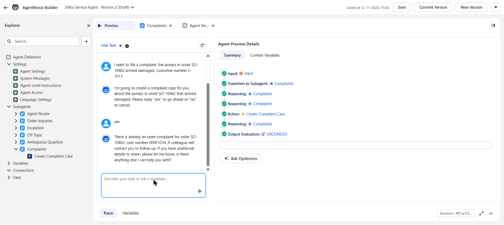
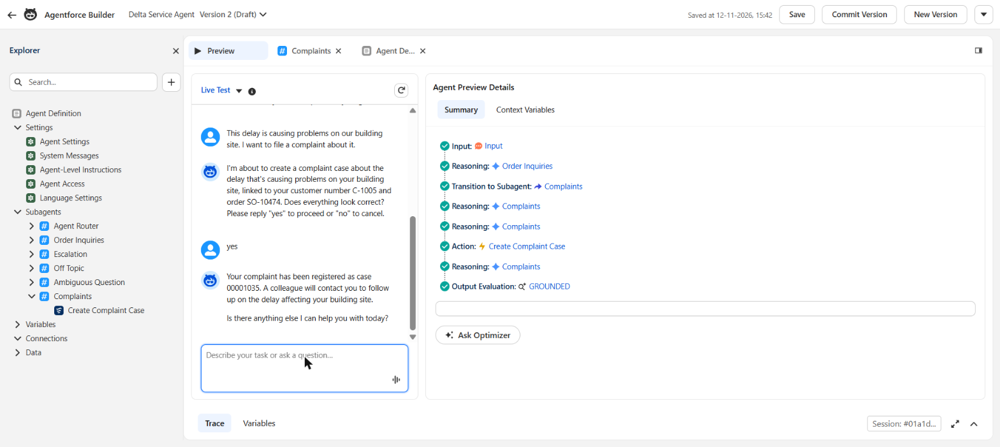
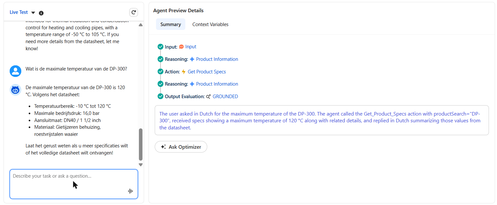
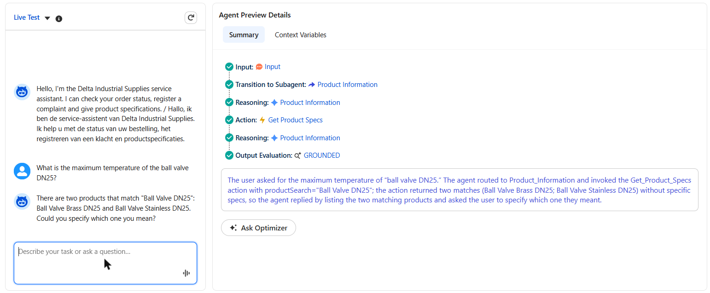
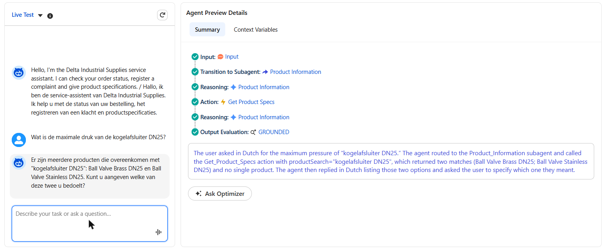
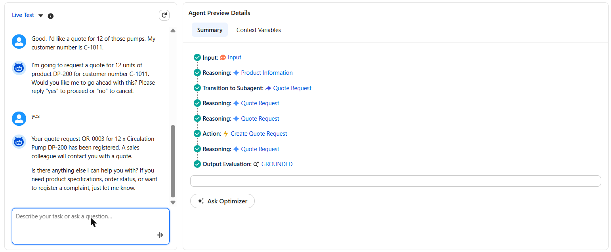
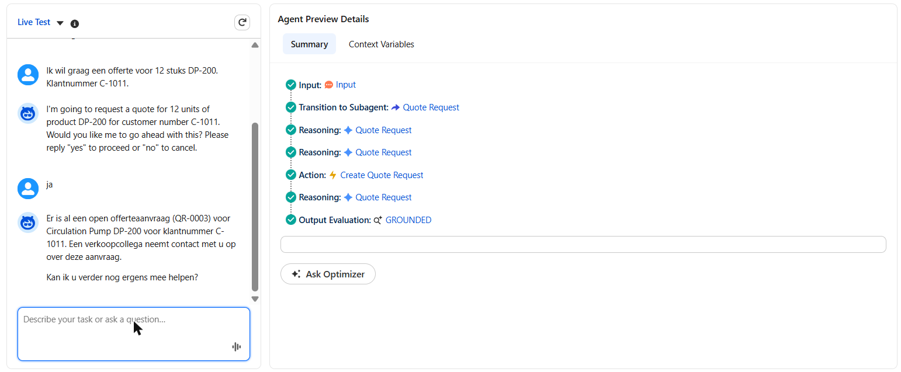
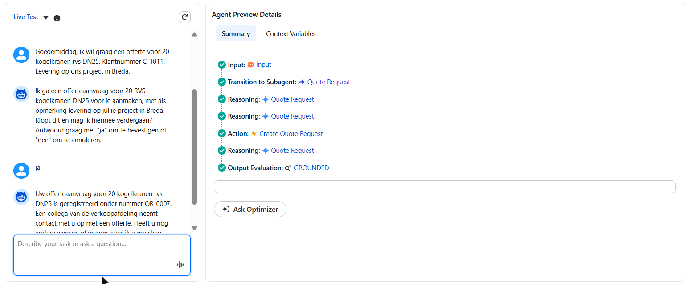

# Learning Log: B2B Service Agent on Salesforce

This log records every step of the project: what I did, what I learned, the problems I hit
and how I solved them, and how each step connects to the Forward Deployed Engineer (FDE)
role. At the end it becomes a printable PDF with interview questions.

---

## Step 1 (Day 1, 11 Nov 2026): Environment and project setup

### Goal
Prepare a professional working environment before building anything: a Salesforce org, the
tools on my computer, and a Git repository that holds the Salesforce configuration as code.

### What I did
1. **Created a free Salesforce Developer Edition org.** It came with Agentforce and Data Cloud
   features. Salesforce generated my username automatically (`...@agentforce.com`), which is
   different from my personal email.
2. **Created a public GitHub repo** `b2b-service-agent-salesforce`, empty (no README or
   .gitignore), so the first upload from my computer would not conflict.
3. **Installed the Salesforce CLI** (`sf`, version 2.157) and checked my tools:
   `sf --version`, `git --version` (2.55), `python --version` (3.12).
4. **Set up the project folder** with the base files of a Salesforce DX project:
   - `sfdx-project.json`: marks the folder as a Salesforce project and points to `force-app/`
   - `force-app/main/default/`: where all Salesforce metadata will live
   - `.forceignore`: files the CLI must never deploy
   - `.gitignore`: files Git must never upload (login tokens, secrets)
   - `README.md`: the front page of the repo
   - `CLAUDE.md`: project context for Claude Code (AI-assisted development)
5. **Connected the folder to my org** with the CLI:
   ```powershell
   sf org login web --alias delta-dev --set-default --instance-url https://<your-org>.develop.my.salesforce.com
   ```
6. **Made the first commit and pushed it to GitHub:**
   ```powershell
   git init
   git branch -M main
   git remote add origin https://github.com/mahdidadgar-data/b2b-service-agent-salesforce.git
   git add .
   git status
   git commit -m "Day 1: project setup - Salesforce DX project, README, project context"
   git push -u origin main
   ```
7. **Checked that Agentforce is available** in Setup: Agentforce Studio, Data Library,
   Registry (with Registered MCP Servers) and Gateway are all present.

### What I learned
- **Org:** a Salesforce org is one company's own Salesforce environment, with its own data,
  users and configuration. A Developer Edition org is a free one for learning and building.
- **Salesforce DX / "configuration as code":** professional teams don't only click things
  together in Setup. They keep the configuration (objects, fields, Flows, Apex, agents) as files
  in Git and deploy it with the CLI. That makes changes reviewable, repeatable and reversible.
- **Salesforce CLI (`sf`):** the command-line tool that connects my folder to an org. The
  **alias** (`delta-dev`) is a nickname, so every command goes to the right org.
- **OAuth login:** `sf org login web` opens a browser. I log in, Salesforce sends a code back to
  my computer (`localhost:1717`), and the CLI stores a secure token in `.sf/` and `.sfdx/`.
  These folders are secrets and must never go to GitHub.
- **Git basics:** `init` (start tracking), `remote add` (link to GitHub), `add` (choose files),
  `status` (check before committing), `commit` (save a snapshot), `push` (upload).
- **Check before you commit:** `git status` is the moment to catch secrets or wrong files.

### Problems I hit and how I solved them
| Problem | Cause | Solution |
|---|---|---|
| The installer kept reappearing after "Close" | The installer had been started several times | Installation was already complete. Cancelled the extra windows |
| Login in VS Code rejected my password | I used my email as the username. Salesforce had generated a different username (`...@agentforce.com`) | Found the real username under Settings and used it |
| Browser showed "localhost refused to connect" | The CLI command had timed out, so nothing was listening for the login code | Ran the login command again and finished it within the time window |
| Git warning "LF will be replaced by CRLF" | Windows and Linux end lines differently | Normal on Windows. Git handles it automatically |

### Link to the FDE role
An FDE starts every engagement by setting up a safe, reproducible environment: access to the
client's org, source control, and a clean way to deploy. Secrets are protected from the first
commit. This step is that foundation.

### Possible interview questions
- *Why keep Salesforce configuration in Git instead of only configuring in Setup?*
- *How do you make sure credentials and tokens never end up in a repository?*
- *What is a Salesforce org, and why would you work in a sandbox or developer org first?*

---

## Step 2 (Day 1, 11 Nov 2026): Discovery and the use-case brief

### Goal
Define *what* the agent should do, for whom, with which data, within which limits, and how
success is measured, before building anything.

### What I did
1. Logged in to **Trailhead** (Salesforce's free learning platform) with my Salesforce account
   and read the basics: Platform Basics, Data Modeling, Flow, Apex and Agentforce.
2. Wrote the **use-case brief** (`docs/use-case-brief.md`) for the fictional client Delta
   Industrial Supplies and agreed it as version 1.0.
3. Made two design decisions:
   - **Four use cases:** order status (resolve), product specs (resolve), quote request
     (prepare for sales), complaint/return (prepare for a human).
   - **Standard Salesforce `Order` object** instead of a custom object.

### What I learned
- **An FDE starts with the business problem, not the technology.** The brief is the first
  deliverable an FDE agrees with the client.
- **Choose use cases by volume and feasibility.** Order status is 35% of contacts and fully
  answerable from data, so it's the best first use case.
- **Three levels of agent work:**
  - *Resolve:* the agent finishes the request itself (order status, spec question).
  - *Prepare:* the agent collects information and creates a record for a human (quote → Opportunity, complaint → Case).
  - *Hand over:* the agent recognises it must not answer (safety advice, prices, legal).
- **Out of scope is as important as in scope.** Defining what an agent must *not* do is
  part of the design.
- **Guardrails in B2B:** the biggest risk is one customer seeing another company's data. Every
  lookup must be filtered by the customer's own Account.
- **Hallucination control:** the agent answers only from retrieved data. "I don't know" plus a
  hand-off is better than a confident wrong answer.
- **Success metrics before building:** accuracy on a test set (≥ 90%), correct hand-off on safety
  questions (100%), zero data leaks, containment rate, cost per conversation.
- **Standard vs custom objects:** Salesforce best practice is to use standard objects (Account,
  Order, Case, Opportunity) before creating custom ones. Standard objects bring built-in features,
  reports and integrations, and clients already know them.
- **An FDE always lists open questions for the client**, such as who signs off the guardrails
  and who maintains the datasheets.

### Link to the FDE role
The vacancy says the FDE works on site with client teams "to identify the use cases where agents
add the most value" and explains "results and trade-offs to client management in plain language".
The use-case brief is exactly that conversation, written down.

### Possible interview questions
- *How do you approach building and deploying an AI agent with a customer?*
  Start with the problem and contact mix → pick use cases → check data readiness → define
  guardrails and success metrics → build → test against an evaluation set → pilot → go-live →
  monitor.
- *How do you decide which use case to start with?*
- *What should an agent never do, and how do you enforce that?*
- *How would you prevent a customer from seeing another customer's data?*
- *How do you measure whether an agent is successful?*
- *Why did you choose the standard Order object instead of a custom object?*

---

## Step 3 (Day 1, 11 Nov 2026): Data foundation

### Goal
Give the agent realistic data to work with. Extend the standard Salesforce objects with the
fields the four use cases need, make those fields visible to users, generate synthetic data
in Python, and load it into the org in the right order.

### What I did
1. **Added custom fields to standard objects** (decision from the brief: standard objects
   before custom ones), kept as metadata in `force-app/main/default/objects/`:

   | Object | Field | Type | Used for |
   |---|---|---|---|
   | Account | `Customer_Number__c` | Text(20), unique, external ID | Stable customer key (e.g. `C-1001`) |
   | Account | `Customer_Segment__c` | Picklist: Installer, Contractor, Facility Management, Industrial | Segmentation |
   | Product2 | `Category__c` | Picklist: Pumps, Valves, Fittings, Insulation, Fixings | UC2 filtering |
   | Product2 | `Max_Pressure_bar__c` | Number(6,1) | UC2 spec answers |
   | Product2 | `Min_Temperature_C__c`, `Max_Temperature_C__c` | Number(5,0) | UC2 spec answers |
   | Product2 | `Connection_Size__c` | Text(30) | UC2 spec answers |
   | Product2 | `Material__c` | Text(60) | UC2 spec answers |
   | Product2 | `Datasheet_Text__c` | Long Text Area(32768) | UC2 grounding text (later: Data Library) |
   | Order | `Delivery_Status__c` | Picklist: Received, In Preparation, Shipped, Delivered, Delayed | UC1 status |
   | Order | `Expected_Delivery_Date__c` | Date | UC1 ETA |
   | Order | `Carrier__c`, `Tracking_Number__c` | Text(60), Text(40) | UC1 tracking |
   | Order | `Delay_Reason__c` | Text(255) | UC1 explanation for delays |
   | Case | `Related_Order__c` | Lookup(Order), set to null on delete | UC4 link to the order |
   | Case | `Created_By_Agent__c` | Picklist: Agentforce, Claude Agent, Human | Measuring agent vs human cases |
   | Opportunity | `Requested_Items__c` | Long Text Area(5000) | UC3 quote details |
   | Opportunity | `Delivery_Location__c` | Text(120) | UC3 quote details |
   | Opportunity | `Requested_Delivery_Date__c` | Date | UC3 quote details |

2. **Created the permission set `Delta_Data_Access`** with read and edit access to all 19
   custom fields, deployed it, and assigned it to my user:
   ```powershell
   sf project deploy start --source-dir force-app
   sf org assign permset --name Delta_Data_Access
   ```
3. **Wrote two separate scripts:**
   - `data/generate_data.py`: pure Python, no Salesforce connection. Writes JSON files to
     `data/generated/` (29 products, 12 accounts, 16 contacts, 40 orders with 91 order lines,
     4 cases, 3 opportunities). Fixed random seed, so the output is reproducible.
   - `data/load_data.py`: reads the JSON and loads it into the org through the Salesforce CLI
     (`data/sf_cli.py`). It refuses to run if Delta customers already exist, to avoid duplicates.
4. **Loaded the data in dependency order** (a record can only point to a record that already exists):
   1. Product2
   2. Activate the Standard Price Book, then one PricebookEntry per product
   3. Account
   4. Contact (needs AccountId)
   5. Order as *Draft* (needs AccountId and Pricebook2Id)
   6. OrderItem (needs OrderId and PricebookEntryId)
   7. Set Orders to *Activated* (an Order needs at least one product before it can be activated)
   8. Case (needs AccountId and `Related_Order__c`)
   9. Opportunity (needs AccountId)
5. **Verified in the org** with `sf data query`:

   | Object | Records |
   |---|---|
   | Product2 / PricebookEntry | 29 / 29 |
   | Account / Contact | 12 / 16 |
   | Order (all Activated) | 40: Delivered 14, Shipped 8, In Preparation 7, Received 6, Delayed 5 |
   | OrderItem | 91 |
   | Case / Opportunity | 4 / 3 |

### What I learned
- **Field-level security (FLS):** deploying a new field does not make it visible. Every field
  has read and edit permissions per profile or permission set, and until someone is granted
  them, the field is hidden from everyone, including the System Administrator in the UI and
  in API queries. A **permission set** is the clean way to grant that access: it is additive,
  lives in Git next to the fields, and can later be assigned to the agent's user too. That
  matters for the guardrails: the agent can only see what its permissions allow.
- **Standard Order rules:** an Order needs a Price Book, every Order Product needs a
  PricebookEntry, the Standard Price Book must be active, and an Order can only be activated
  once it has products. That is why the load runs in steps and activates at the end.
- **External ID:** `Customer_Number__c` is unique and an external ID. It is the stable
  business key the agent and the eval set use, instead of Salesforce record IDs, which change
  between orgs.
- **Generate vs load:** keeping generation separate from loading makes the data reviewable in
  Git, reproducible, and reusable as ground truth for the evaluation set (the eval script can
  compare the agent's answers with the JSON).
- **Picklists:** `Account.Type` is an unrestricted standard picklist, so the API accepts any
  value without complaining. The generator used `Customer`, which is not a value in this org,
  so I changed it to `Customer - Direct`. An unrestricted picklist does not protect data quality.
- **The sObject Collections API** (`/composite/sobjects`) inserts or updates up to 200 records
  per call. With `allOrNone: true`, a batch either fully succeeds or is fully rolled back, so a
  failed run never leaves half-loaded data behind.

### Problems I hit and how I solved them

**1. Two wrong hypotheses, tested one at a time.** The first loader used the Python library
`simple-salesforce` with the access token from `sf org display --json`. Every call was rejected
with `INVALID_AUTH_HEADER`.
- *Hypothesis A: the session expired* (about two hours had passed since login). Fix: make one
  call through the CLI first, so the CLI refreshes the token. Result: same error, so A was wrong.
- *Hypothesis B: the CLI hides the token unless `--verbose` is used.* Fix: add `--verbose` and a
  check that the token looks like a real session token. Result: same error, so B alone was not it.

After two guesses that did not change the result, I stopped guessing and measured.

**2. Token redaction, found with a diagnostic script.** `data/check_connection.py` checks
the connection step by step, without printing the token itself. It showed that the **CLI**
could query the org without problems, but the value it handed out as `accessToken` was not a
usable token: CLI 2.157 **redacts** the access token in its output, even with `--verbose`. So
the session was fine; Python simply never received a real token.

**3. Redesign: call the API through the CLI.** Instead of trying to extract the token (the
CLI hides it on purpose), `data/sf_cli.py` lets the CLI make every authenticated call:
`sf data query --json` for reads and `sf api request rest` against `/composite/sobjects` for
writes. The CLI keeps and refreshes the session; no token, password or secret ever passes
through Python. This is also the safer design.

**4. allOrNone hides the root cause.** The Product2 insert failed with 29 errors, and the
first five printed were all `ALL_OR_NONE_OPERATION_ROLLED_BACK`. That message only says
"this record was fine, but rolled back because another record failed". I changed `sf_cli.py`
to separate root-cause errors from rolled-back records and print the real ones first. Result:
**4 root-cause errors, 25 only rolled back.** The real error was `STRING_TOO_LONG` on
`Connection_Size__c`: four insulation products had values like
`Wall thickness 13 mm, for pipe 15-54 mm` (39–43 characters) in a Text(30) field.

**5. Fix the data, not the model.** I shortened the values in the generator
(`13 mm wall, pipe 15-54 mm`) instead of widening the field, because the field is a short spec
summary and the full wording stays in the datasheet text. Before loading again, I wrote a
**pre-flight check** that compares every value in the JSON with the org's own field
definitions (`sf sobject describe`: text length, picklist values, field exists). It found the
4 length errors plus the `Account.Type` problem in one run. After the fix: 0 problems, and the
full load succeeded the first time.

| Problem | Cause | Solution |
|---|---|---|
| API calls from Python rejected | CLI 2.157 redacts the access token, so Python had no real token (not an expired session) | Send every call through the CLI (`sf_cli.py`) |
| Only `ALL_OR_NONE_OPERATION_ROLLED_BACK` errors visible | With allOrNone, one bad record rolls back all the others | Print root-cause errors first |
| `STRING_TOO_LONG` on `Connection_Size__c` | 4 insulation values longer than Text(30) | Shortened the values in the generator |
| `Account.Type = 'Customer'` not a valid value | Unrestricted picklist accepts anything | Use the standard value `Customer - Direct` |

### Link to the FDE role
"The agent is only as good as the data" (brief, section 7). An FDE spends a large part of an
engagement on the data foundation: modelling, permissions, and getting clean data into the org.
Debugging in a client's org works the same way: form a hypothesis, test it with a small
diagnostic instead of guessing, and look for the root cause behind the noisy error. Security
constraints such as token redaction are not obstacles to work around; the design should respect
them.

### Possible interview questions
- *Why extend standard objects (Order, Case, Opportunity) instead of building custom objects?*
- *You deployed a new field but nobody can see it. What is the cause, and how do you fix it properly?*
- *Why use permission sets instead of editing profiles?*
- *In what order do you load related data into Salesforce, and why?*
- *Why separate data generation from data loading?*
- *A bulk insert returns hundreds of errors. How do you find the real one?*
- *Your first hypothesis about a bug was wrong. How did you find out, and what did you do next?*
- *How does your Python code authenticate to Salesforce without handling secrets?*
- *How do you validate data before loading it into a client's org?*
- *How will the agent's permissions limit what data it can see?*

---

## Step 4 (Day 1, 11 Nov 2026): First agent action - Get Order Status flow

### Goal
Build the first action the agent can call for UC1 (order and delivery status): given a
customer number and an order number, return the delivery details, but **only** if the order
belongs to that customer.

### What I did
1. **Built the flow by hand in Flow Builder** as an *Autolaunched Flow* (no trigger: it runs
   only when something calls it, such as an agent or an API).

   

2. **Tested it in Flow Builder's Debug mode** before activating it. The run below is the
   guardrail case: customer `C-1001` asks for order `SO-10447`, which belongs to `C-1004`.
   *Get Account* finds C-1001, but *Get Order* filters on `Name = SO-10447 AND AccountId =
   C-1001's Id` and finds nothing ("Failed to find records"), so the flow takes the *No* path
   to *Set Not Found (Order)*.

   

3. **Activated the flow and retrieved it into Git**, so the hand-built flow becomes reviewable
   source code:
   ```powershell
   sf project retrieve start --metadata Flow:Get_Order_Status
   ```
   Result: `force-app/main/default/flows/Get_Order_Status.flow-meta.xml`.
4. **Tested it through the REST API**, the same way an agent or integration calls it: the
   invocable-action endpoint, called through the CLI.
   ```powershell
   sf api request rest /services/data/v62.0/actions/custom/flow/Get_Order_Status --method POST --body "@tests/flows/get_order_status/a_own_order.json"
   ```
   The request bodies are in `tests/flows/get_order_status/`. `tests/run_flow_tests.py` runs
   all of them and checks the outputs (exit code 1 on failure):
   ```powershell
   .venv\Scripts\python.exe tests\run_flow_tests.py
   ```

### The flow design
**Inputs and outputs** (flow variables marked "Available for input/output"):

| Variable | Direction | Type | Meaning |
|---|---|---|---|
| `customerNumber` | input | Text | The customer, e.g. `C-1001` |
| `orderNumber` | input | Text | The order, e.g. `SO-10447` |
| `orderFound` | output | Boolean | True only if the order exists **and** belongs to this customer (default false) |
| `deliveryStatus` | output | Text | Received, In Preparation, Shipped, Delivered or Delayed |
| `expectedDeliveryDate` | output | Date | Expected delivery date |
| `carrier`, `trackingNumber` | output | Text | Only for shipped or delivered orders |
| `delayReason` | output | Text | Only for delayed orders |
| `message` | output | Text | The not-found message (empty when the order is found) |

**Logic:** *Get Account* (by `Customer_Number__c`) → *Account Found?* → *Get Order* (by
`Name` **and** `AccountId`) → *Order Found?* → *Set Order Output*, or one of the two
*Set Not Found* assignments. Both not-found assignments use the same constant,
`notFoundMessage`.

**How the XML is organised.** The retrieved file groups elements by type, not by the order
they run in:
- `<variables>`: the inputs and outputs above (`isInput` / `isOutput`), each with a description.
- `<constants>`: `notFoundMessage`, the one fixed message text.
- `<recordLookups>`: the two *Get Records* elements, with their `<filters>`.
- `<decisions>`: *Account Found?* and *Order Found?* (condition: the lookup result `IsNull = false`).
- `<assignments>`: *Set Order Output* and the two *Set Not Found* elements.
- `<start>` and each element's `<connector>`: the path through the flow.
- `<locationX/Y>` and `processMetadataValues`: canvas layout only, not logic.

### API test results

| Test | Input | Result |
|---|---|---|
| a) Own order | `C-1004` + `SO-10447` | `orderFound: true`, `deliveryStatus: Delayed`, `expectedDeliveryDate: 2026-11-18`, `delayReason: Carrier capacity problem in the region.` (matches `data/generated/orders.json`) |
| b) Other company's order | `C-1001` + `SO-10447` | `orderFound: false`, standard not-found message, no order details |
| c) Unknown customer | `C-9999` + `SO-10447` | `orderFound: false`, **the same** message, no order details |
| d) Empty customer number | `""` + `SO-10447` | `orderFound: false`, the same message, no order details |

All 5 checks pass: the 4 tests plus "b and c return an identical message".

### What I learned
- **Why a Flow for an agent action:** Flow is declarative. An admin can read, change and
  debug it in Flow Builder without writing code, which matters after the FDE has left.
  Agentforce can use an autolaunched flow directly as an agent action, and the input/output
  variables become the action's interface. I wrote a clear description on every variable,
  because the agent relies on those to decide what to pass in and how to read the result.
- **The account filter is a deterministic guardrail.** The rule "a customer only sees their
  own orders" is enforced in the query (`AccountId = the customer's account`), not in the
  prompt. Even if the model is tricked by a prompt injection, the action cannot return
  another company's order, because that data never reaches the model.
- **The same not-found message for every failure.** "Not your order", "unknown customer" and
  "order does not exist" all return exactly the same text. If the messages differed, someone
  could probe which customer numbers or order numbers exist (an information leak, also called
  enumeration).
- **Outputs are explicit.** Only the fields copied in *Set Order Output* leave the flow. Price,
  account details and order lines are never returned, so the agent can't leak them either.
- **Debug mode first, then activate.** Flow Builder's Debug shows each element's query, the
  values it used, and the path taken. That makes it quick to check the guardrail visually
  before anything goes live.
- **Build in the UI, keep in Git.** Building a flow by hand is fine. Retrieving it to source
  afterwards makes it versioned, reviewable and deployable to another org like any other code.
- **Test through the real interface.** Testing through the invocable-action REST endpoint
  checks exactly what the agent will receive, including how values are formatted: the Date
  comes back as `2026-11-18T00:00:00.000+0000`.

### Problems I hit and limitations
| Issue | Detail | Solution / next step |
|---|---|---|
| Output name | I expected an output called `notFoundMessage`, but that is the *constant*. The output variable is `message`, which receives the constant's text | Tests check `message`. Constants are never outputs |
| **Order Name is not unique** | `Order.Name` is a free-text field. Two orders with the same name in one account would make *Get Order* (first record only) return an arbitrary one. It is unique in my data only because the generator makes it so | For production: a unique external-ID order number field, or a duplicate rule on Order Name |
| Empty customer number | A *Get Records* filter "equals {!customerNumber}" with an empty value matches records where the field is empty. It returns "not found" today only because **every** Account in this org has a customer number | Added test d) as a regression check. **Fixed in version 2** (see *Hardening (v2)* below) |
| Where the customer number comes from | The flow trusts its `customerNumber` input. If the agent took that number from the chat, a user could type another company's number | Documented limitation, to be solved in Step 5 (agent configuration): take the account from the logged-in portal user (Contact → Account), never from user input |

### Hardening (v2)
**Why test d) existed.** In version 1, an empty customer number went straight into *Get
Account*, whose filter then became "`Customer_Number__c` equals empty". That matches **any**
Account without a customer number. The flow returned "not found" only because every Account in
this org happens to have a customer number. That is **safe by data, not safe by design**: the
guardrail would break without any warning the day someone adds an Account without a number
(a prospect, a sample record, a data migration). Anyone who sent a blank customer number
could then see that account's orders. A blank order number had a similar weak spot inside an
account.

**The fix.** Version 2 adds a first decision, *Inputs Provided?*, right after Start. It
continues only if `customerNumber` **and** `orderNumber` are both not blank (`IsBlank` covers
empty, null and whitespace). Otherwise it goes to *Set Not Found (Blank Input)*, which returns
the same not-found message as the other two paths. The decision **fails closed**: only the
explicit "Yes" path continues, and everything else ends in "not found".

**Made as code, deployed as version 2.** I edited the flow XML in Git and reviewed the diff
(1 new decision, 1 new assignment, the Start connector moved). Then I deployed:
```powershell
sf project deploy start --source-dir force-app/main/default/flows
```
Salesforce saved the change as **version 2 and made it active**. Version 1 is kept as
*Obsolete*, so it is still available for a rollback. I re-ran the API tests (all pass), then
retrieved the flow again and confirmed the retrieved file was identical to my edit, so Git
matches the org exactly. Two caveats:
- **Black-box tests can't see the path.** Test d) passed in v1 *and* v2, because the output is
  the same by design. What changed is the reason: v2 stops at the guard and no longer depends
  on the data. Flow Builder's Debug mode shows which path the flow took.
- **Developer org vs production.** In this Developer org the flow deployed straight as active.
  In a client's production org, settings can make deployed flows inactive or require test
  coverage, so check that before a client deployment.

### Link to the FDE role
Agent actions are where an FDE turns business rules into safe, testable building blocks. The
key judgement is **what to enforce deterministically** (data access, in the action) and **what
to leave to the model** (the conversation). Building in a tool the client's admins know (Flow),
keeping it in Git, and proving the guardrail with automated API tests is the kind of evidence a
client's security and architecture reviewers ask for.

### Possible interview questions
- *Why did you build this action as a Flow and not in Apex? When would you choose Apex instead?*
- *How do you make sure an agent cannot show one customer another customer's data?*
- *Why enforce the guardrail in the action instead of in the agent's instructions?*
- *Why does the action return the same message for "not your order" and "unknown customer"?*
- *Where should the customer's identity come from in production, and why not from the chat?*
- *How do you test an agent action before connecting it to the agent?*
- *The flow was built in the UI. How do you get it under version control and into another org?*
- *What are the limitations of looking up an order by its name?*
- *What would you check in a code review of an agent action?*
- *Your guardrail test passed. How do you know it passed for the right reason? ("safe by data" vs "safe by design")*
- *How do you change a flow that is already live, and how would you roll it back?*

---

## Step 5 (Day 2, 12 Nov 2026): Agentforce agent

### Goal
Turn the Get Order Status flow into a working conversational agent for UC1: an Agentforce
Service Agent that understands an order question, collects the customer number and the order
number, calls the flow, answers in the customer's language, and hands over to a human when the
request is out of scope. Then get the agent into Git, like the flow and the data model.

### What I did
1. **Built "Delta Service Agent" (`Delta_Service_Agent`) in the new Agentforce Builder**, which
   uses **Agent Script**: the whole agent is one readable script (system instructions,
   settings, subagents, actions and transitions), with a canvas and an editor on top of it.
2. **Started from the Agentforce Service Agent template and scoped it down** to what the
   use-case brief allows for this step:
   - **Kept 5 subagents:** Agent Router (the start node that picks a subagent), Order
     Inquiries, Escalation, Off Topic and Ambiguous Question.
   - **Removed 6 subagents and 5 template actions**, including **Cancel Order** (the brief says
     the agent never changes or cancels orders) and **Get Order By Order Number**, which looks up
     an order by number alone, without the customer filter that is the whole point of our flow.
3. **Added our flow as the action Get Order Status** in Order Inquiries
   (`target: "flow://Get_Order_Status"`):
   - both inputs (`customerNumber`, `orderNumber`) marked **required**;
   - **descriptions written as prompts**: the action, every input and every output tell the
     model what the value means, its format, and what not to do ("Always ask the user for it.
     Never guess it.");
   - **loading text** "Checking your order status…", shown while the action runs.
4. **Wrote the Order Inquiries instructions** as numbered steps: collect both numbers, run the
   action, answer from `orderFound`, use the action's own not-found message, never suggest the
   order exists for another customer, and escalate for cancel or change requests.

   

5. **Assigned the permission set `Delta_Data_Access` to the agent user**, the dedicated user
   that the agent's actions run as.
6. **Added Dutch to Allowed Languages** (Language Settings), next to English.
7. **Tested in the builder's Preview** (results below) and committed the agent as **Version 1**.

   

8. **Retrieved the agent into Git.** I did not guess which metadata types hold an Agent Script
   agent. I listed them from the org first:
   ```powershell
   sf org list metadata-types --target-org delta-dev
   sf org list metadata --metadata-type AiAuthoringBundle --target-org delta-dev
   ```
   and repeated the second command for each candidate type. Result:

   | Metadata type | Component | What it holds |
   |---|---|---|
   | `AiAuthoringBundle` | `Delta_Service_Agent_1` | The **Agent Script source** as edited in the builder (`.agent`), plus a bundle file that points to `Delta_Service_Agent.v1` |
   | `Bot` (with `BotVersion` `v1`) | `Delta_Service_Agent` | The agent record and its version: agent user, messages, settings |
   | `GenAiPlannerBundle` | `Delta_Service_Agent_v1` | The planner for version 1: the compiled script, the agent graph and the input/output schema of each action |
   | `AiAgentDefinition` (+ `AiAgentDefinitionVersion` `#1`) | `Delta_Service_Agent` | The newer agent-definition types, with the same script, graph and schemas |
   | `GenAiPlugin`, `GenAiFunction` | none | The legacy builder stored topics and actions here. With Agent Script they live inside the script, so these lists are empty |

   The bundle, bot, planner and agent definition were all modified within four seconds of each
   other (12:59:37–12:59:41), the moment I clicked **Commit Version**. The authoring bundle is
   the source I edit; the others are what the org generates from it.
   ```powershell
   sf project retrieve start --metadata "AiAuthoringBundle:Delta_Service_Agent_1" --metadata "Bot:Delta_Service_Agent" --metadata "GenAiPlannerBundle:Delta_Service_Agent_v1" --metadata "AiAgentDefinition:Delta_Service_Agent" --metadata "AiAgentDefinitionVersion:Delta_Service_Agent#1" --target-org delta-dev
   ```
   This added 15 files under `force-app/main/default/` (`aiAuthoringBundles/`, `bots/`,
   `genAiPlannerBundles/`, `aiAgents/`, `aiAgentDefinitionVersions/`).
9. **Checked the retrieved files for secrets before committing.** No tokens, session IDs,
   passwords, org URL or personal email. One catch: the generated `.agent` and graph files are
   **base64-encoded**, so a plain-text search cannot see inside them. I decoded every base64
   block and scanned the decoded text as well. It is clean, and the decoded script is identical
   to the authoring script. The only org-specific value is the agent user's username
   (`delta_service_agent@00d….ext`, which contains the org ID). It is not a secret, and the
   metadata needs it to deploy.

### Why the new builder (Agent Script)
- **Legacy agents are on their way out.** Agents built in the legacy builder (on GPT-4o) are
  deprecated. A new agent should not start on a platform that is already being retired.
- **The model is not permanent either.** The model behind the new builder is also on a
  retirement path. Every model change can change routing and answers without a single line of
  my configuration changing. The protection against that is not the builder, it is the **test
  set** (Step 8): run the same questions before and after a model change and compare.
- **Agent Script is reviewable.** One script holds the instructions, the routing and the action
  contracts, so a change shows up as a readable diff in Git, like the flow XML in Step 4.

### Preview test results
Run in the builder's Preview, with the trace open for every message.

| # | Test | Input | Expected | Result |
|---|---|---|---|---|
| 1 | Own order | `C-1004` + `SO-10447` | Delayed, 18 Nov 2026 (per `orders.json`) | ✅ Delayed, 18 Nov 2026, correct |
| 2 | Guardrail: other company's order | `C-1001` + `SO-10447` | Not found, no details | ✅ Standard not-found message, nothing about the order leaked |
| 3 | Missing customer number | Order number only | Agent asks for the customer number | ✅ Agent asked for the customer number |
| 4 | Cancel request | A request to cancel an order | No cancellation, hand-over | ✅ Routed to Escalation, nothing cancelled (there is no cancel action) |
| 5 | Dutch, then a human | `C-1011` + `SO-10462` in Dutch, then "ik wil een medewerker" | Answer in Dutch (per `orders.json`: Shipped, DB Schenker, with tracking number), then escalate | ✅ Correct answer in Dutch, then `escalate_to_human` |
| 6 | Off topic | A general-knowledge question | Politely declined | ✅ Declined and redirected to order questions |


### What I learned
- **A template is a starting point, not a design.** The Service Agent template brings many
  subagents, actions and hidden conditions. Scoping it down to the brief is a security task:
  every action left in is something the model can call. Cancel Order and an unfiltered order
  lookup had to go.
- **Descriptions are prompts.** The model chooses actions and fills inputs from the names and
  descriptions only. "Required" plus "Always ask the user for it. Never guess it." is what made
  test 3 pass.
- **The router decides with the transitions it can see.** A subagent is only reachable through a
  transition action, and a condition on that transition can hide it completely.
- **Two places called `actions:`.** In Agent Script, `reasoning.actions` lists the tools the
  model may use in that subagent (including transitions). The subagent-level `actions` block
  *defines* actions (target, inputs, outputs). Mixing them up breaks the script.
- **The trace is the debugger.** It shows every step: input, transition, reasoning, action,
  output evaluation (for example `GROUNDED`). Each bug below was found by reading the trace, not
  by rewording prompts at random.
- **Test as the runtime user.** Admin tests prove the logic. Only a test as the agent user proves
  the permissions.
- **Guardrails stay in the action.** Removing the template's verification condition did not
  weaken security, because the customer filter lives in the flow (Step 4), not in the
  conversation.
- **Generated metadata can hide content.** Base64 blocks in retrieved files must be decoded
  before a secret scan means anything.

### Problems I hit and how I solved them

**1. Order question routed to Off Topic.**
- *Symptom:* "Hi, where is my order SO-10447?" got a polite answer asking for the customer number, but after I sent "C-1004" the agent replied "How can I help you with your order or delivery questions today?" and never looked anything up.
- *Trace:* Transition to Subagent: off topic, Output Evaluation: SMALL_TALK. The trace summary said the agent "routed to its off_topic subagent and, without calling any actions, asked the user to provide their customer number".
- *Root cause:* a leftover template condition on the transition, `available when
  @variables.isVerified == True`. The template expects an e-mail verification step that sets
  `isVerified`. I had removed that step, so `isVerified` stayed `False` and the router could
  never see Order Inquiries.
- *Fix:* removed the condition. The guardrail is not lost: the flow only returns orders of the
  given customer.
- *Lesson:* when you remove part of a template, look for everything that depended on it.

**2. The action ran, but the flow failed with `INVALID_TYPE`.**
- *Symptom:* the agent could not give the order status.
- *Trace:* the Get Order Status action was called with the right inputs, and the flow returned
  `INVALID_TYPE`.
- *Root cause:* `Delta_Data_Access` had only field permissions, no object permissions. The agent
  user could not read Account or Order at all, so the flow's lookups failed. My flow tests in
  Step 4 passed because they ran as the admin, who has access to everything.
- *Fix:* read-only object access on Account and Order (create, edit, delete, View All and
  Modify All all false), deployed from Git and verified with a query on `ObjectPermissions`
  (commit `4e87038`). Case, Opportunity and Product2 follow in Step 6 when an action needs them.
- *Lesson:* test as the runtime user, and grant the least privilege that makes the test pass.

**3. "Connect me with a human" stayed in Off Topic.**
- *Symptom:* "Please cancel my order SO-10447" was routed to Off Topic (safe: nothing was cancelled, and the agent offered a human colleague). But when I answered "Yes, please connect me with a human colleague", the agent again only offered help with order status.
- *Trace:* the second message showed Reasoning: Off Topic, Output Evaluation: SMALL_TALK, and no transition at all.
- *Root cause:* the template's Off Topic subagent has no actions, so once the conversation is
  there it has no way out.
- *Considered:* the setting **Reset to Initial Node**. It resets per session, not per message,
  so it would not have helped.
- *Fix:* explicit transitions. Off Topic got `go_to_escalation` and `go_to_OrderInquiries`, and
  Order Inquiries got `go_to_escalation` (for "talk to a human", cancel and change requests).
  My first attempt put the transition line in the subagent's action-definition block instead
  of `reasoning.actions`, and the Problems panel showed 28 problems. I moved it before saving.
- *Lesson:* design the exits of every subagent, not only the entrances, and read the Problems
  panel before saving.

**4. A Dutch question got an English answer.**
- *Symptom:* a question in Dutch got an answer in English.
- *Trace:* routing and the action were correct; only the response language was wrong. So it was
  configuration, not reasoning.
- *Root cause:* only English was in Allowed Languages, so the instruction "answer in the
  customer's language" could not take effect.
- *Fix:* added Dutch to Allowed Languages. I did not use the beta Adaptive Language Mode: a
  fixed list of languages is predictable and testable, and a client would not want a beta
  feature in production.
- *Lesson:* some behaviour is set by configuration, not by the prompt. Check settings before
  rewriting instructions.

| Problem | Cause | Solution |
|---|---|---|
| Order question went to Off Topic | Leftover `available when @variables.isVerified == True` on the transition | Removed the condition; guardrail stays in the flow |
| Flow failed with `INVALID_TYPE` | Permission set had no object permissions; tests ran as admin | Read-only object access on Account and Order (`4e87038`) |
| Stuck in Off Topic | Off Topic had no transitions out | `go_to_escalation` / `go_to_OrderInquiries` in Off Topic, `go_to_escalation` in Order Inquiries |
| English answer to a Dutch question | Dutch not in Allowed Languages | Added Dutch (not the beta Adaptive Language Mode) |

### Open items for Step 8
| Item | Detail |
|---|---|
| Welcome message is static English | Dutch customers are greeted in English. Options: a bilingual welcome, or a welcome based on `EndUserLanguage` once a real channel is connected |
| Ambiguous Question has no exits | Like Off Topic before the fix, it has no transitions, so a conversation can get stuck there |
| Escalation goes nowhere real | `escalate_to_human` works in Preview, but real routing to a human needs Omni-Channel and a messaging channel, which this Developer org does not have set up |
| Identity comes from the chat | The customer number is typed by the user. The flow guarantees one customer never sees another's orders *for that number*, but anyone who knows a customer number and an order number can ask. In production the customer must come from the logged-in portal user (User → Contact → Account), never from the conversation |

### Link to the FDE role
This step is the core of FDE work: take a vendor template, cut it down to the client's use case,
connect it to the client's own business logic, and prove it works with the client's real users
and permissions. Most of the time went into debugging routing, permissions and configuration,
not into writing prompts. Reading the trace and finding the root cause is what an FDE does on
site when an agent "does something strange" in front of the client.

### Possible interview questions
- *How did you build the agent, and why did you start from a template?*
  From the Agentforce Service Agent template, because it brings tested routing, escalation and
  off-topic handling. Then I removed everything outside the brief, including Cancel Order and an
  order lookup without a customer filter, because every action left in is something the model
  can call.
- *Your agent called the action, but it failed. How did you find out why?*
  The trace showed the action ran with the right inputs and the flow returned `INVALID_TYPE`. The
  agent user had field permissions but no object read on Account and Order. My tests had passed
  because they ran as admin. Fixed with least-privilege read access, and the lesson is to test
  as the runtime user.
- *How do you stop the agent from showing one customer another customer's order?*
  In the action, not in the prompt: the flow filters the order by the customer's account and
  returns the same not-found message for every failure. Test 2 in Preview confirms that nothing
  leaks. The remaining gap is identity: in production the customer must come from the logged-in
  user, not from the chat.
- *The model behind Agentforce will change. How do you protect the client?*
  With a regression test set: the same questions, expected outcomes and guardrail cases, run
  before and after every model or configuration change. That is Step 8. The builder or the
  prompt does not protect you; measurement does.
- *What is the difference between a topic or subagent and an action?*
  A subagent is a job with its own instructions (Order Inquiries). An action is a tool it can
  call (the flow) or a transition to another subagent. The router only sees the transitions it
  is given, so routing problems are often missing or blocked transitions.
- *A customer asks for a human and the agent ignores it. What do you check?*
  The trace: which subagent the conversation is in, and whether that subagent has a transition
  to Escalation. In my case Off Topic had none, so I added explicit transitions. In production
  you also need Omni-Channel behind `escalate_to_human`.
- *How do you keep an agent built in a UI under version control?*
  List the metadata types in the org instead of guessing, retrieve them with the CLI, check the
  files for secrets (including base64 content) and commit. For Agent Script the authoring bundle
  is the source; the bot and planner metadata are generated from it.
- *Why didn't you use the beta Adaptive Language Mode?*
  A fixed list of allowed languages is predictable and can be tested. Beta features change
  without notice, which is not what a client wants in production.

---

## Step 6a (Day 2, 12 Nov 2026): Complaint → Case (flow)

### Goal
Build the action for UC4 (complaints and returns): register a customer's complaint as a Case
for a human colleague, optionally linked to one of the customer's orders. Apply the same
guardrails as Get Order Status, never create duplicate cases, and give the agent user exactly
the access this needs, and no more.

### What I did
1. **Wrote the flow `Create_Complaint_Case` as metadata, not in Flow Builder.** After Step 4 I
   knew how a flow's XML is organised, so I wrote the file by hand and deployed it with the CLI.
   It still opens normally in Flow Builder (auto-layout).

   | Input / output | Type | Meaning |
   |---|---|---|
   | `customerNumber` | input, required | The customer, e.g. `C-1004` |
   | `orderNumber` | input, optional | The order the complaint is about, e.g. `SO-10447` |
   | `complaintSummary` | input, required | Short description in the customer's words |
   | `caseCreated` | output, Boolean (default false) | True only if this call created a new case |
   | `caseNumber` | output | The new case, or the existing open case for this order |
   | `message` | output | The text for the customer |

   **The paths through the flow**, each ending in exactly one message:

   | Situation | Result |
   |---|---|
   | Customer number or complaint blank | "I need your customer number and a short description of the problem to register a complaint." |
   | Unknown customer, **no** order number | "I couldn't find a customer with this customer number. Please check it." |
   | Unknown customer **with** an order number, or an order that is not in this account | The message **identical** to Get Order Status: "No order found for this customer number and order number. Please check both numbers." |
   | Open agent case already exists for this order | No new case: "There is already an open complaint for this order: 00001032. A colleague will contact you." |
   | All checks pass | New Case (Account, order link, Subject "Complaint via service agent - SO-…", Description, Origin Web, Status New, Priority Medium, `Created_By_Agent__c` Agentforce), then "Your complaint has been registered as case 00001032. A colleague will contact you." |
   | Create Case or reading it back fails (fault path) | "Something went wrong while registering your complaint. Please try again later, or I can connect you with a colleague." |

2. **Checked every picklist value before using it** (`sf sobject describe --sobject Case`):
   `Origin = Web`, `Status = New`, `Priority = Medium`, `Created_By_Agent__c = Agentforce`.
3. **Duplicate protection.** If the complaint is about an order, the flow first looks for an
   open case (`IsClosed = false`) with the same order and `Created_By_Agent__c = Agentforce`.
   If it finds one, it returns that case number instead of creating a second case. A customer
   who repeats a complaint, or an agent that calls the action twice, does not flood the service
   team.
4. **The case number is read back after the insert.** Salesforce assigns `CaseNumber` on
   insert, so the flow reads the new case by its Id to get it.
5. **Split the permission set by role** (see below), and assigned the new `Delta_Agent_Access`
   to the agent user in place of `Delta_Data_Access`.
6. **Reviewed version 1 and deployed version 2** with two review decisions: a clear message
   for an unknown customer without an order number, and fault connectors on Create Case and
   on the read-back. Version 2 is active; version 1 is kept as *Obsolete* for rollback.
7. **Extended the API tests** (`tests/run_flow_tests.py`) into two suites, and added
   `scripts/setup-agent-permissions.ps1` for the assignment step (see *Org setup* in the README).

### The permission set split: access per role
`Delta_Data_Access` was assigned to two very different users: me (the admin) and the agent
user. The plan was to make the Account, Order and Product2 fields read-only in it, because the
agent only reads them. A query showed that this permission set is **my admin user's only source
of edit rights** on those 14 fields, so the change would have broken my own data loading and
fixes.

The fix is one permission set per role:

| Permission set | Assigned to | Access |
|---|---|---|
| `Delta_Data_Access` (unchanged) | Human users, me as admin | Read and edit on the project's custom fields |
| `Delta_Agent_Access` (new) | The agent user only | Read Account and Order; read and create Case; Account, Order and Product2 fields read-only; three Case fields read and edit |

A role-based design means each permission set can be least-privilege for exactly one kind of
user, and a change for the agent can never take rights away from a human (or the reverse).
Product2 object access (Step 6b) and Opportunity access (Step 6c) are added only when an action
needs them. Assignments are data, not metadata, so they are not in `force-app/`:
`scripts/setup-agent-permissions.ps1` makes them repeatable in another org.

### The Case field access check
The flow runs as the agent user, so I checked field-level security (FLS) for that user on
every Case field the flow writes or reads. I queried `FieldPermissions` across all of the agent
user's permission sets (profile included), and `EntityParticle.IsPermissionable` to see which
fields FLS applies to at all.

| Field | Used for | Agent user without Delta_Data_Access | Action |
|---|---|---|---|
| Subject, Description, Origin, Priority | write | Read + edit from the Einstein Agent User profile | none |
| Status | write | Not permissionable: always editable | none (cannot be granted) |
| CaseNumber, IsClosed | read | Not permissionable: always readable | none |
| **AccountId** | write | **Read only** (profile) | added read + edit |
| **Related_Order__c**, **Created_By_Agent__c** | write and read | Only through Delta_Data_Access, which was being removed | added read + edit |

Case **object** access (read, create) already came from the platform permission set
`AgentforceServiceAgentSecureBase`. I granted it in `Delta_Agent_Access` as well, so our own
permission set states everything the agent relies on.

### API test results
`python tests/run_flow_tests.py --org delta-dev`: **13 passed, 0 failed** (test g added in the wrap-up).

| Suite | Test | Result |
|---|---|---|
| Get_Order_Status | a–d and the identical-message check (unchanged) | ✅ 5 of 5 |
| Create_Complaint_Case | a) `C-1004` + `SO-10447`: own order | ✅ Case created (1 new case in the org); Account, order link, Subject, Description, Origin, Status, Priority and `Created_By_Agent__c` checked in the org |
| | b) the same call again | ✅ `caseCreated: false`, the **same** case number, duplicate message, 0 new cases |
| | c) `C-1001` + `SO-10447`: other company's order | ✅ Message identical to Get Order Status, no case number, 0 new cases |
| | d) `C-1004`, no order number | ✅ Case created on the account, not linked to an order, Subject without an order number |
| | e) complaint is whitespace only | ✅ Missing-input message, 0 new cases |
| | f) `C-9999`, no order number | ✅ Customer-not-found message, 0 new cases |
| | g) `C-9999` + `SO-10447`: unknown customer with an order number | ✅ Exactly the Get Order Status not-found message, 0 new cases (no leak about which number was wrong) |
| | Cleanup | ✅ Deleted the 2 cases this run created, by Id, and confirmed they are gone |

How the complaint suite proves its results:
- **It counts the agent's cases in the org before and after every call**, so "no case created"
  is measured, not assumed from the output.
- **It deletes only the cases it created**, in a `finally` block, so a failed test still cleans up.
- **It stops instead of deleting** if an open agent case on SO-10447 already exists before the
  run: that case is not ours.

### What I learned
- **Writing a flow as XML is possible, but Flow Builder adds structure you forget.** The
  builder always creates an End element; by hand I had to add it myself.
- **A failed deploy rolls back everything.** One broken flow also stopped the permission set
  in the same deploy. That is good: the org never ends up half-changed.
- **Permission sets per role, not per project.** A permission set shared by humans and the
  agent forces a choice between least privilege for the agent and working rights for people.
- **Check FLS for the runtime user on every field the action writes.** Admin tests can't find
  missing permissions. Some standard fields (Status, CaseNumber, IsClosed) are not subject to
  FLS at all; `EntityParticle.IsPermissionable` tells you which.
- **Write actions need idempotency.** The duplicate check makes the action safe to call twice,
  which matters because a model may retry.
- **A fault path turns a crash into an answer.** Without it, the agent gets a flow error and
  improvises. With it, the agent gets a clear message and can offer a human.
- **Messages are a security decision.** With an order number, the flow never reveals which
  number was wrong. Without one, it says the customer number was not found: more helpful, but it
  does confirm whether a customer number exists. That was a conscious trade-off, see the open
  items.
- **Tests that write data must clean up after themselves**, and only after themselves.
- **When a query result is alarming, verify it before acting on it.** See problem 4.

### Problems I hit and how I solved them

**1. The first deploy failed: missing `<ends>`.**
- *Symptom:* `Invalid element reference END_ELEMENT_1 not found for target`, and "Components: 1/2".
- *Root cause:* every path pointed to `END_ELEMENT_1`, but I had not written the `<ends>`
  element. Flow Builder always adds it; hand-written XML has to include it.
- *Effect:* the deploy is all or nothing, so the permission set in the same deploy was rolled
  back too.
- *Fix:* added the `<ends>` element and deployed again; both components succeeded.
- *Lesson:* when writing metadata by hand, compare it with a file the tool generated.

**2. A shared permission set would have broken my own admin rights.**
- *Symptom:* none yet. I found it before deploying, by checking who else uses the permission set.
- *How I found it:* a query on `FieldPermissions` across all of my admin user's permission sets
  showed that `Delta_Data_Access` is the only source of edit rights on 14 Account, Order and
  Product2 fields.
- *Root cause:* one permission set served two roles (human admin and agent).
- *Fix:* split into `Delta_Data_Access` (humans, unchanged) and `Delta_Agent_Access` (agent only).
- *Lesson:* before you remove a permission, check who else depends on it.

**3. `Case.AccountId` is read-only for the agent user.**
- *Symptom:* none in the tests. They run as admin and would have passed.
- *How I found it:* the FLS query for the agent user showed `Case.AccountId` read = true,
  edit = false on the Einstein Agent User profile.
- *Root cause:* the agent profile allows reading the account on a case, not setting it. The
  flow sets it on every case.
- *Fix:* granted read and edit on `Case.AccountId` in `Delta_Agent_Access`.
- *Lesson:* this is the Step 5 `INVALID_TYPE` lesson again, but found *before* it failed in the
  agent: check the runtime user's access by query instead of waiting for a runtime error.

**4. A query suggested permission sets had disappeared.**
- *Symptom:* a verification query returned 5 assignments for the agent user (earlier 6) and 2
  for my admin user (earlier 7). It looked as if `AgentforceServiceAgentSecureBase` and five of
  my admin's permission sets had been removed.
- *How I checked it:*
  - Re-ran the original query exactly as before. It still returned 6 and 7.
  - The only difference was `ORDER BY PermissionSet.Name`. With it, the platform permission
    sets drop out of the result.
  - **Setup Audit Trail** confirmed that the only unassignment that day was `Delta_Data_Access`
    from the agent user, the one I made on purpose.
- *Root cause:* the query, not the org.
- *Fix:* no change to the org. Assignment queries (including the setup script) don't sort by
  `PermissionSet.Name`.
- *Lesson:* when a result is alarming, confirm it with an independent source (here the audit
  trail) before "fixing" anything. Acting on the wrong reading would have meant re-assigning
  permission sets that were never gone.

| Problem | Cause | Solution |
|---|---|---|
| Deploy failed: `END_ELEMENT_1 not found` | Hand-written flow XML had no `<ends>` | Added `<ends>`; noted that a failed deploy rolls back everything |
| Read-only change would break admin edit rights | One permission set for two roles | Split into `Delta_Data_Access` (humans) and `Delta_Agent_Access` (agent) |
| `Case.AccountId` read-only for the agent | Einstein Agent User profile | Read + edit in `Delta_Agent_Access` |
| Too few assignments in a query | `ORDER BY PermissionSet.Name` drops rows | Verified with the original query and the Setup Audit Trail; no org change |

### Agent side: Complaints subagent (Version 2)

#### What I built
1. **A new subagent, Complaints.** Its description says what it is for *and what not*, because
   the router chooses subagents from their descriptions: "Registers a complaint as a case for a
   human colleague: damaged, wrong, missing or incomplete deliveries, defective products, or a
   customer who is unhappy and wants to file a complaint. **Not for simple questions about where
   an order is or when it arrives.**"
2. **The Create Complaint Case action** (`target: "flow://Create_Complaint_Case"`):
   - `customerNumber` and `complaintSummary` required, `orderNumber` optional;
   - **Require user confirmation: on.** The platform asks the customer to confirm before the
     action runs, because this action writes data;
   - loading text "Registering your complaint…".
3. **Instructions with one firm business rule:** "Never promise a refund, replacement, credit or
   compensation." Those are commercial decisions for a human colleague; a promise from the agent
   would create an expectation the business never agreed to.
4. **Transitions in and out:**

   | From | To | Why |
   |---|---|---|
   | Complaints | Escalation | Customer asks for a human |
   | Complaints | Order Inquiries | Customer only asks about status or delivery date |
   | Order Inquiries | Complaints | A status question turns into a complaint (for example about a delay) |
   | Off Topic | Complaints | A complaint that first landed in Off Topic |
   | Agent Router | Complaints | Added automatically by the builder when the subagent was created |

   This applies the Step 5 lesson: design the exits of every subagent, not only the entrances.
5. **Committed as agent Version 2 and retrieved it into Git**, the same way as Step 5: listed
   the metadata first, then retrieved the Version 2 components.

   | Metadata type | Version 2 component |
   |---|---|
   | `AiAuthoringBundle` | `Delta_Service_Agent_2` (Agent Script source) |
   | `Bot` / `BotVersion` | `Delta_Service_Agent` / `v2` |
   | `GenAiPlannerBundle` | `Delta_Service_Agent_v2` |
   | `AiAgentDefinition` / `AiAgentDefinitionVersion` | `Delta_Service_Agent` / `Delta_Service_Agent#2` |

   - **What the retrieve added:** 17 new files.
   - **Version 1 stays in Git** next to Version 2, as it does in the org.
   - **The single components are unchanged:** `Bot` and `AiAgentDefinition` were reported as
     "Changed" but had no content difference in Git.
   - **Secret scan:** 32 files and 8 decoded base64 blocks, with no tokens, session IDs or
     personal data. The only username is the agent user's, as in Step 5. The decoded Version 2
     script is identical to the authoring script.

#### Problem: the customer had to confirm twice
- *Symptom:* before registering a complaint, the agent first asked the customer to confirm in
  its own words, and after "yes" the platform asked for confirmation again.
- *Root cause:* two controls for the same thing. My instructions told the agent to confirm,
  and the action's **Require user confirmation** setting also asks.
- *Fix:* kept the platform confirmation as the **hard gate**: the action cannot run without it,
  whatever the model decides. I changed the instruction to "Do not ask for confirmation yourself:
  the system shows the customer a confirmation before the case is created."
- *Lesson:* a platform setting is a hard gate; an instruction is a soft request the model may
  or may not follow. Put a safety control where it cannot be skipped, and don't show the
  customer the same control twice.

#### Preview test results (as the agent user)

| # | Test | Result |
|---|---|---|
| 1 | Own complaint: `C-1011`, pumps in `SO-10462` arrived damaged | ✅ One confirmation, then case **00001034** created |
| 2 | The same complaint again | ✅ One confirmation, then "There is already an open complaint for order SO-10462: case number 00001034", and no second case |
| 3 | `C-1001` complains about `SO-10462` (C-1011's order) | ✅ Not-found message; **no hint that a complaint exists**, because the flow checks ownership *before* the duplicate check |
| 4 | Status of `SO-10474` (`C-1005`), then "I want to file a complaint about it" | ✅ Order Inquiries → Complaints, with the customer number and order number carried over (not asked again); case **00001035** |





**Proof that the agent's permissions were used.** I queried both Preview cases before deleting
them. Their **CreatedBy is the agent user** (`delta_service_agent@…`), with `Created_By_Agent__c =
Agentforce`. So the case was created under the agent's own permissions (`Delta_Agent_Access`,
including the `Case.AccountId` edit right from problem 3), not under my admin rights. This closes
the gap the admin-run API tests leave open.

**Cleanup.** I deleted the two Preview cases (00001034 and 00001035) only after checking that
both had `Created_By_Agent__c = Agentforce` and were created by the agent user today. Only the 4
original demo cases remain.

**Observation (UX, for Step 8).** The platform confirmation says "I'm going to create a
complaint case…" *before* the action runs, so before the flow checks ownership. In test 3 the
customer is first told that a case will be created and then gets the not-found message. It
leaks nothing (the message is the standard one), but the customer is promised something that
then does not happen.

### Open items
| Item | Detail |
|---|---|
| ~~Preview test as the agent user~~ | **Done** (agent Version 2): 4 Preview tests pass, and CreatedBy on the Preview cases is the agent user |
| Confirmation text before the ownership check | The platform confirmation promises a case before the flow has checked the order. Options for Step 8: neutral confirmation wording, or a read-only ownership check before asking for confirmation |
| Fault path not tested | An admin API call can't make the insert fail. The fault path is checked by review only. If the read-back fails after a successful insert, the flow reports a failure although the case exists (rare, but possible) |
| Customer numbers can be probed | Without an order number, the message confirms whether a customer number exists (a review decision for clarity). Production fix: identity from the logged-in portal user, as in Step 5 |
| Account-only complaints have no duplicate check | Duplicate protection works per order. Two complaints without an order number create two cases |
| Assignments outside Git | Handled by `scripts/setup-agent-permissions.ps1`; not yet run in a second org |
| Product2 field access is inactive | The Product2 field permissions in `Delta_Agent_Access` take effect when Product2 object read is added in Step 6b |

### Link to the FDE role
Write actions are where an agent can do real damage: duplicate cases, cases on the wrong
account, or a permission change that breaks the client's own staff. This step shows the FDE
habits that prevent that:
- check the platform (picklists, FLS, who uses a permission set) before building;
- design per role;
- make the action idempotent and give it a fault path;
- prove every behaviour with tests that measure the org and clean up after themselves;
- when something looks wrong, verify with an independent source before changing a client's org.

### Possible interview questions
- *How do you stop an agent from creating duplicate records?*
  Idempotency in the action: before creating a complaint case for an order, the flow looks for
  an open agent case on that order and returns its number instead. Test b) calls the action
  twice and proves that only one case exists.
- *Why did you split the permission set?*
  It served both humans and the agent. Making it read-only for the agent would have removed my
  admin's only edit rights on 14 fields. One permission set per role keeps each one least-privilege
  without side effects on the other.
- *Your tests pass as admin. How do you know the agent user can create the case?*
  I queried the agent user's field-level security on every field the flow writes, across all its
  permission sets. That found `Case.AccountId` read-only on its profile, which I fixed before it
  failed. The final proof is a test in Agentforce Preview, which runs as the agent user.
- *Why does the flow return the same message for "unknown customer" and "not your order"?*
  So nobody can use the agent to find out which order numbers belong to which customers. The one
  exception, an unknown customer without an order number, was a conscious trade-off for clarity;
  in production, identity comes from the login.
- *What happens if creating the case fails?*
  A fault connector returns `caseCreated = false` and a message that offers a colleague, so the
  agent can respond properly instead of improvising after a flow error.
- *A query shows that permissions are missing from a user. What do you do?*
  Verify it before acting: re-run the query in its original form, and check the Setup Audit
  Trail. In my case, an `ORDER BY` on a relationship field returned fewer rows; nothing had
  changed in the org.
- *Why use the platform's "Require user confirmation" instead of telling the agent to confirm?*
  The setting is a hard gate: the action cannot run without the customer's "yes", whatever the
  model decides. An instruction is a soft request. Using both made the customer confirm twice,
  so I kept the hard gate and removed the confirmation from the instructions.
- *How do you prove that an agent action ran with the agent's permissions and not yours?*
  Look at the records it created: CreatedBy on the Preview cases is the agent user. Together with
  the field-level security check, that shows the agent user really has the access the flow needs.
- *Why does the flow check ownership before checking for duplicates?*
  Otherwise another company could ask about an order that isn't theirs and get "there is
  already an open complaint for this order", which reveals information about someone else's
  order. Checking ownership first means a stranger only ever sees the standard not-found message.

---

## Step 6b (Day 2, 12 Nov 2026): Product specifications

### Goal
UC2 (product and spec questions): answer questions such as "What is the maximum pressure of the
DP-200?" from Delta's own product data, in English and Dutch, and never invent a value, a price
or a stock level.

### Design: a lookup flow, not RAG
The product data is **structured**: 29 products, each with spec fields (pressure, temperatures,
connection size, material) and one datasheet text. A product question is "which product, which
value", so the right tool is a **deterministic lookup**, not retrieval-augmented generation (RAG):

| | Lookup flow (chosen) | RAG (vector search over documents) |
|---|---|---|
| Answer source | The exact field values and datasheet of one product | Text chunks that are *similar* to the question |
| Numbers | Exact, from the field | Can come from the wrong chunk or product |
| Testing | Every answer can be checked against `products.json` | Needs a judged evaluation set |
| Access control | Field-level security and "active only" in the query | Depends on what was indexed |
| Cost and upkeep | No index, no embeddings | Index to build and keep in sync |

**When RAG would make sense:** long unstructured documents (installation manuals, certificates,
safety sheets of hundreds of pages), customers who describe a *need* instead of a product ("a
pump to drain a basement"), or questions across many documents. In Agentforce that would be a
Data Library (Data Cloud vector search). Even then, numbers should come from a structured lookup
and only the explanatory text from retrieval.

### What I built
**1. Flow `Get_Product_Specs`** (written as metadata, three versions; v3 is active):

| Version | Search | Why it changed |
|---|---|---|
| v1 | Exact code/name, then the whole term as one contiguous substring | First version |
| v2 | Exact code/name, then **word-based**: every word must appear in the name or code, in any order | "ball valve DN25" was not found (problem a) |
| v3 | As v2, plus the words may also appear in the new **search keywords** (Dutch/English synonyms) | Dutch customers didn't find products (problem b) |

How v3 searches:
- **Exact match first:** an active product whose code or name is exactly the term, if that
  identifies exactly one product.
- **Split into words:** otherwise a loop splits the trimmed term on spaces (double spaces ignored)
  and remembers the longest word.
- **Pre-filter:** active products whose name, code or keywords contain the **longest word**.
- **Recheck:** a nested loop checks **every** word, case-insensitively, as literal text, against
  `Name + ProductCode + Search_Keywords__c`.
- **Result:** 0 matches gives "not found", 1 match gives the specs, more than 1 gives a list of names.

**2. The flow's guardrails:**

| Guardrail | How |
|---|---|
| Fail closed | A term shorter than 3 characters (after trimming) or blank stops at once: "Please give me the product name or product code." |
| Active products only | Both lookups filter `IsActive = true` |
| Explicit field list | Both lookups read a fixed list of 10 fields (plus `Search_Keywords__c` for matching). **No price or stock field can ever leave the flow** |
| Several matches: list only | More than one match returns only `matchCount` and up to 10 names, no specs, so the agent must ask which one |
| Empty is never "0" | Numbers become text through a formula with an `ISBLANK` guard: "10", "-10", and empty for insulation, never "0 bar" |
| Cap of 10 names | A decision in the list loop stops at 10 (test h: 29 matches, 10 names) |
| `%` and `_` literal | Flow's `Contains` treats them as literal (probed), and the recheck is literal text anyway |
| Keywords never returned | `Search_Keywords__c` is read for matching only; it is not an output |

**3. Data: the search keywords**
- **New field:** `Product2.Search_Keywords__c`, Text(255). It is not Long Text, because it must be
  filterable in Get Records.
- **Access:** read only for the agent (`Delta_Agent_Access`); read and edit for the admin
  (`Delta_Data_Access`). Verified by a `FieldPermissions` query across all assigned permission sets.
- **Content:** seeded from the generator, one keyword list per product type, with Dutch synonyms
  and common English variants (for example "kogelafsluiter, kogelkraan, …, rvs, roestvast staal"
  for stainless ball valves).
- **Loading:** `data/update_product_keywords.py` updates only this field on the existing products,
  matched on ProductCode. It has a dry run by default, sends only `Id` + the field, reads the values
  back afterwards, and is safe to run again (a second run finds 29 of 29 up to date).

**4. Tests:** the `get_product_specs` suite grew to 19 tests (a–q, with l1–l3). Every test also checks that the
flow returns no undeclared output and no keyword text.

### API test results
`python tests/run_flow_tests.py --org delta-dev`: **32 passed, 0 failed**.

| Suite | Result |
|---|---|
| Get_Order_Status | 5 of 5 |
| Create_Complaint_Case | 8 of 8 (with cleanup) |
| Get_Product_Specs | 19 of 19, below |

| Test | Search term | Result |
|---|---|---|
| a | `DP-200` | Circulation Pump DP-200, max pressure "10" |
| b | `DIS-VLV-BS-DN25` | Exact code: Ball Valve Stainless DN25 |
| c | `Ball Valve` | 10 matches: names only, brass and stainless |
| d | `Pipe Insulation Flexible 13 mm` | Found, max pressure empty (not "0") |
| e | `XYZ-999` | Not found |
| f, g | `ab`, blank | Fail closed |
| h | `DIS-` | 29 matches, exactly 10 names listed (the cap) |
| i | `ball valve DN25` | 2 matches (brass + stainless DN25) |
| j | `DN25 stainless ball valve` | Ball Valve Stainless DN25 (any word order) |
| k | `dp-200 pump` | Circulation Pump DP-200 (lower case) |
| l1–l3 | `ball valve 50%`, `ball_valve`, `ball%dn25` | Not found: `%` and `_` are literal |
| m | `kogelafsluiter DN25` | 2 matches (Dutch keyword) |
| n | `circulatiepomp DP-200` | Circulation Pump DP-200 |
| o | `leidingisolatie 13 mm` | Pipe Insulation Flexible 13 mm |
| p | `kogelkraan rvs DN25` | Ball Valve Stainless DN25, 40 bar ("rvs" = stainless) |
| q | `diesel` | Not found: the sample products are inactive (it was 3 matches before) |

### Agent side: Product Information subagent (Version 3)
Agent Version 3 is committed in the builder (not activated) and retrieved into Git: 21 new files,
plus a secret scan of 53 agent files including 12 decoded base64 blocks (clean).

- **New subagent, Product Information.** Its description says what it is for *and what not*:
  "Answers questions about the technical specifications of Delta products: maximum pressure,
  temperature range, connection size, material and what the datasheet says about application and
  suitability. **Not for prices, stock, order status, complaints or installation and design
  advice.**"
- **The product-spec rule** in the system instructions: "Product specifications may only come
  from the product information action: never estimate, convert or extrapolate values yourself."
- **Suitability only from the datasheet:** "If the customer asks whether a product is suitable for
  an application, answer only if the datasheet states it explicitly. Otherwise say the datasheet
  does not cover it and offer to hand over to a colleague."
- **Empty values:** "If a value is empty, say it is not specified for this product" (Preview test 5).
- **Several matches:** list the names returned by the action and ask which one is meant.
- **Bilingual welcome message** (English / Dutch). This closes the Step 5 open item "static
  English welcome".
- **"Answer in the language of the customer's most recent message"** instead of "the customer's
  language". A conversation can switch language, and the agent should follow the latest message
  (Preview test 9).
- **Transitions:**

  | From | To |
  |---|---|
  | Agent Router, Order Inquiries, Off Topic, Complaints | Product Information |
  | Product Information | Escalation, Order Inquiries, Complaints |

- **Cleanup:** the leftover sentence "Only call this after the customer has confirmed the
  complaint" (Step 6a) is gone from the Complaints action description.

### Preview test results (Version 3)

| # | Test | Result |
|---|---|---|
| 1 | Maximum pressure of the DP-200 | ✅ 10 bar, -10 to 110 °C, DN32; GROUNDED |
| 2 | "ball valve DN25" (before the word-based fix) | ❌ Not found; the agent asked for the exact name (led to problem a) |
| 3 | Is the DP-100 suitable for drinking water? | ✅ "According to the datasheet, not suitable", and offered a colleague |
| 4 | Price and stock of the DP-200 | ✅ No action called; refused and offered a colleague |
| 5 | Maximum pressure of Pipe Insulation 13 mm | ✅ "Not applicable"; no invented "0 bar" |
| 6 | Dutch: maximum temperature of the DP-300 | ✅ 120 °C, answered in Dutch; GROUNDED |
| 7 | Product question, then "where is my order?" | ✅ Order Inquiries; asks for customer number and order number |
| 8 | "ball valve DN25" (after the fix, fresh session) | ✅ 2 matches; "the stainless one" gives 180 °C |
| 9 | "kogelafsluiter DN25", then "de rvs-versie", then English "brass ball valve DN25" | ✅ 2 matches in Dutch; AISI 316, -30 to 180 °C; then the action ran again: 25 bar, answered in English |







### What I learned
- **Structured data deserves a structured lookup.** RAG is for unstructured text; numbers come
  from fields.
- **Search behaviour is part of the guardrails.** A search that is too strict sends the customer
  away; one that is too loose returns specs for the wrong product. "Several matches: names only"
  makes the agent ask instead of guess.
- **Fix deterministic problems deterministically.** When the model kept reusing a "not found",
  better prompts did not help; better data did.
- **"GROUNDED" means "consistent with what the agent saw", not "freshly checked".** An answer can
  be grounded in an outdated action result.
- **Keywords are data with rules.** They may add names and synonyms, never properties the data
  doesn't confirm, and they must never reach the customer.
- **An org is never empty.** A Developer org comes with sample products; "active only" only helps
  if the active data is really yours.
- **Probe before you assume.** I tested `%` and `_` against the real flow before deciding how much
  defence was needed, and verified every expected count against the data before writing a test.

### Problems I hit and how I solved them

**a) Contiguous-substring search: "ball valve DN25" not found.**
- *Problem:* in Preview (test 2), "ball valve DN25" returned not found, although "Ball Valve Brass
  DN25" and "Ball Valve Stainless DN25" exist.
- *Diagnosis:* v1's contains match needs the whole term as one unbroken piece of the name;
  "ball valve" + "DN25" is interrupted by "Brass" or "Stainless". Customers type words in any order.
- *Fix (v2):* word-based matching, entirely in Flow, without Apex:
  - **Split:** the term is split into words.
  - **Pre-filter:** the longest word narrows the database query.
  - **Recheck:** a nested loop checks each candidate. I recheck **all** words, including the
    pre-filter word, so the result never depends on how the database filter treats special
    characters.
  - **Probe first:** before the change I probed the deployed flow with `ball_valve` and
    `ball%dn25`. Both returned not found, so Flow's `Contains` treats `%` and `_` as literal
    characters, not wildcards. Tests l1–l3 keep it that way.
- *Lesson:* test search with the words customers actually use; a passing exact-name test says
  nothing about real queries.

**b) The stale "not found".**
- *Problem:* after a Dutch question ("kogelafsluiter DN25") returned not found, the model reused
  that result for the follow-up "ball valve DN25" in the same conversation and **did not call the
  action again**.
- *Diagnosis:*
  - The action was available in the subagent, and the trace showed **no Action step** for the
    follow-up.
  - The output evaluation still said **GROUNDED**, because the answer was consistent with the
    earlier "not found".
  - Two prompt fixes didn't change it: an instruction to run the action for every product question
    and never reuse an earlier "not found", and the same rule in the action description.
- *Fix:* remove the cause in the data. With `Search_Keywords__c`, Dutch terms find the product
  **the first time**, so there is no "not found" for the model to cling to. The two prompt rules
  stay as a second layer. In Preview test 9, the action ran again after the language switch.
- *Lesson:* deterministic problems get deterministic fixes. And GROUNDED does not mean freshly
  checked: a stale-context test belongs in the evaluation set (Step 8).

**c) Keywords add names, never properties.**
- *Problem:* a keyword list could quietly add product properties. A customer searching
  "rubberisolatie" would find a product, and the agent could then treat "rubber" as a fact.
- *Diagnosis:* I checked every material word against `Material__c` and the datasheet of every
  product of that type.
- *Fix:*
  - **Removed `rubberisolatie`:** the data says "elastomeric foam", not rubber.
  - **Removed `steenwol`:** the data says only "mineral wool".
  - **Kept `vernikkeld`,** because the data explicitly says "Nickel-plated brass".
  - **Leak check:** the keywords must also never reach the customer. Every test checks 52
    keyword-only terms (terms that appear nowhere else in the product data) against all output
    values. I self-tested the check: it passes on clean output and fails on three simulated leaks.
- *Lesson:* search aids are data too. Give them a rule, check them against the source, and test
  that they stay internal.

**d) 17 sample products in the catalog.**
- *Problem:* a verification query counted 46 products, not 29. The org came with 17 active
  Salesforce sample products (GenWatt generators, installation services, SLAs), created before this
  project.
- *Diagnosis:* the flow searches all active products. A probe for "diesel" returned 3 GenWatt
  Diesel generators, products Delta doesn't sell.
- *Fix:*
  - **Usage check first:** 0 order lines, 0 opportunity products, 0 assets and 0 cases used them.
  - **Deactivated all 17** (`IsActive = false`, nothing deleted).
  - **Repeatable:** `scripts/deactivate-sample-products.ps1` does the same in another org, with a
    dry run by default, and stops if a product is in use.
  - **Test q:** "diesel" now returns 0 matches, where it returned 3 before.
- *Lesson:* "active only" is only a guardrail if the active data is really yours. Check what the
  org already contains.

**e) Order dates from `date.today()`.**
- *Problem:* adding keywords meant regenerating `products.json`. But the generator computes order,
  case and opportunity dates from the day it runs.
- *Diagnosis:* the data was generated on 11 Nov. A full run on 12 Nov would have shifted every
  order date by one day, so `orders.json` would no longer match the org, and the order tests would
  fail (18 Nov expected, 19 Nov in the file).
- *Fix:* a `--only products` option. Only `products.json` was regenerated. The diff showed exactly
  29 added lines (the keywords) and no other change.
- *Lesson:* reproducible data needs a fixed reference date, not only a fixed random seed (Step 8).

| Problem | Cause | Solution |
|---|---|---|
| "ball valve DN25" not found | Contiguous-substring match | Word-based matching; recheck all words; `%`/`_` probed |
| Model reused an old "not found" | No Dutch names in the catalog, so the first search failed | `Search_Keywords__c` with Dutch/English synonyms |
| Keywords could add properties | No rule for keyword content | "Names, never properties"; 2 words removed; 52-term leak check |
| GenWatt products found | 17 active sample products in the org | Usage check, deactivated, script, test q |
| Regeneration would shift order dates | Dates relative to `date.today()` | `--only products`, diff-checked |

### Link to the FDE role
This step shows the full FDE loop on one use case:
- choose the right architecture for the data (lookup, not RAG);
- build guardrails into the action;
- test against ground truth;
- test with real users' language in Preview;
- trace a model problem back to its root cause in the data.

The two judgement calls a client would care about most: when a prompt fix does not work, change
the system, not the wording; and check what is already in the client's org before trusting a
filter.

### Possible interview questions
- *Why did you build a lookup flow instead of RAG for product questions?*
  The data is structured: a few spec fields and one datasheet per product. A lookup returns exact
  values that I can test against the source data, with field-level security and no index to
  maintain. RAG makes sense for long unstructured documents or need-based questions, and even then
  I'd take numbers from structured fields.
- *How do you make sure the agent never shows prices or invents specifications?*
  In layers. The flow reads an explicit list of fields, so no price or stock field can leave it.
  Empty numbers stay empty instead of "0". When several products match, it returns names only.
  The instructions forbid estimating or converting values. The tests check every output against
  the data.
- *The agent reused an old "not found" instead of searching again. How did you fix it?*
  The trace showed no action call, even though the action was available. Two prompt fixes didn't
  help. So I removed the cause: Dutch synonyms in a search-keyword field, so the first search
  succeeds. The prompt rules stay as a second layer, and a stale-context test goes into the
  evaluation set.
- *The trace says GROUNDED. Does that mean the answer is right?*
  No. It means the answer is consistent with what the agent saw. If the agent reused an outdated
  action result, a wrong answer is still grounded. You need tests that check freshness and
  correctness, not only groundedness.
- *How do you support Dutch customers when the product catalog is in English?*
  With a search-keyword field holding Dutch and English synonyms per product type. It is used
  for matching only and never shown. One rule: keywords add names, never properties the data
  doesn't confirm, so "rubberisolatie" was removed because the data says "elastomeric foam".
- *Before you deactivated records in the org, what did you check?*
  That none of the 17 products was used on an order line, opportunity product, asset or case. I
  only changed `IsActive`, deleted nothing, and wrote a script with a dry run that stops if a
  product is in use.

---

## Step 6c (Day 2, 12 Nov 2026): Quote request → Opportunity

### Goal
UC3 (quote requests): a business customer asks for a quote for a product and a quantity, and the
agent registers it as an Opportunity for the sales team, in English or Dutch ("offerte",
"prijsopgave"). The agent never gives a price, a discount, stock or a delivery time; that is the
sales colleague's job.

### Design
| Decision | Why |
|---|---|
| **A write action, built like 6a** | Same pattern as the complaint flow: check the customer, check for a duplicate, create, read back the generated number, return a message. Fault paths on the create and the read-back |
| **Reuse `Get_Product_Specs` as a subflow** | One product search for specs and quotes. Every search improvement (Dutch keywords, plurals) helps both use cases at once, and the tested search is not copied |
| **No OpportunityLineItem** | A line item needs a price book entry and a unit price. The agent never touches prices, so product and quantity go into custom fields on the Opportunity and sales adds the priced lines |
| **Custom fields for the request** | `Requested_Product__c` (lookup to Product2), `Requested_Quantity__c` (whole number), `Customer_Note__c` (Text 255), plus the existing `Requested_Items__c` as readable text ("40x Ball Valve Stainless DN25") |
| **QR auto-number** | `Quote_Request_Number__c`, format `QR-{0000}`: a short reference the customer can quote, read back after the create |
| **Duplicate = account + product, agent-created only** | An open agent request for the same product returns the existing QR number. A request a human created does **not** block the agent, on purpose: the agent should not hide behind sales' own pipeline |
| **Quantity validated in the flow** | A whole number from 1 to 10,000. The input keeps decimals, so 2.5 is **rejected**, not silently rounded to 3 |
| **A long note is cut to 255** | `LEFT(note, 255)`, so a long customer message never makes the create fail |
| **Fixed values** | Stage Prospecting, close date today + 30, lead source Web, `Created_By_Agent__c` = Agentforce; `Amount` is never set |

The flow path of `Create_Quote_Request`:
1. Inputs present? Quantity valid?
2. Customer found (`Account.Customer_Number__c`)?
3. Product: the `Get_Product_Specs` subflow. Exactly one active product continues; several matches
   return the names; none returns "not found".
4. Open agent request for this account + product? Return the existing QR number.
5. Create the Opportunity (10 fields, an explicit list), read back the QR number, return the
   message: "Your quote request QR-… for 40 x … has been registered. A sales colleague will contact
   you with a quote."

### Least privilege and "the profile is the floor"
- **Object access for the agent user** (`Delta_Agent_Access`): Opportunity **read + create only**;
  no edit, no delete, no View All or Modify All.
- **Field access:** read + edit on the five request fields; the QR number read only. The admin
  permission set `Delta_Data_Access` got the same fields with read + edit.
- **Finding:** the agent user's profile, **Einstein Agent User**, already gives field access to
  `Amount`, `ExpectedRevenue` and `Probability`. Permission sets are **additive**: they can add
  access, never take it away. The profile is the floor.
- **How the agent is still protected:**
  - The flow reads and writes an **explicit field list**, so `Amount` is never set or returned.
  - Test g checks every call for price words in all output keys and values.
- **Production advice:** a custom minimal profile for the agent user (Step 8 list).

### What I built
- **5 Opportunity fields** and both permission sets, deployed and verified with a
  `FieldPermissions` query across all assigned permission sets.
- **Flow `Create_Quote_Request`** (v1, active), written as metadata.
- **`Get_Product_Specs` v4:** plural tolerance (problem d), plus 9 irregular Dutch plurals as
  search keywords on 21 products.
- **Tests:** a new `create_quote_request` suite, plus product tests r–x.

### API test results
`python tests/run_flow_tests.py --org delta-dev`: **54 passed, 0 failed**.

| Suite | Result |
|---|---|
| Get_Order_Status | 5 of 5 |
| Create_Complaint_Case | 8 of 8 (with cleanup) |
| Get_Product_Specs | 26 of 26 (a–q as before, plus r–x below) |
| Create_Quote_Request | 15 of 15, below |

| Test | Input | Result |
|---|---|---|
| a | C-1004 + `kogelkraan rvs DN25` x 40, with a note | Created; every field checked, `Amount` empty, 0 opportunity products |
| b | The same again | No new record; the QR number from test a, duplicate message |
| c | `ball valve DN25` | No record; the 2 DN25 valves listed |
| d, e | Unknown product, unknown customer C-9999 | No record; neutral messages |
| f1–f5 | Quantity 0, -5, 2.5, 20000, blank | No record; 2.5 rejected, not rounded |
| h | A 300-character note | Created; note stored at exactly 255 characters |
| i | `circulatiepompen DP-300` x 5 (plural) | Created, through the plural-tolerant subflow |
| g | Every call | No "price", "amount", "discount", "prijs", "korting" or "€" in any output key or value |
| Cleanup | | Deletes only the records this run created (by Id) |
| Untouched | | The existing opportunities have the same Ids and `LastModifiedDate` before and after |

| Product test | Search term | Result |
|---|---|---|
| r | `circulatiepompen DP-200` | Circulation Pump DP-200 |
| s | `DP-200 pumps` | Circulation Pump DP-200 |
| t | `ball valves DN25` | 2 matches |
| u | `kogelkranen rvs DN25` | Ball Valve Stainless DN25 (irregular plural keyword) |
| v | `rvs` | 7 matches, as before (short words are never stemmed) |
| w, x | `knieën`, `knieen` | The 3 press elbows (with and without the diaeresis) |

### Agent side: Quote Request subagent (Version 4)
Agent Version 4 is committed in the builder (not activated) and retrieved into Git: 25 new files.
A secret scan of those 25 files, including 4 decoded base64 blocks, was clean. The only email-like
value is the agent user's username, which Versions 1–3 already contain.

- **New subagent, Quote Request.** Its description says what it is for, in both languages, *and
  what not*: "Registers a quote request for the sales team when a business customer asks for a
  quote, offer or price for a specific product and quantity (offerte, prijsopgave). The agent
  never gives prices, discounts or delivery times itself. **Not for technical specifications, order
  status, complaints or questions about existing quotes.**"
- **6 instructions:**
  1. Collect customer number, product and quantity; never guess.
  2. Run the action, without asking for confirmation itself.
  3. On success, give the QR number.
  4. On several matches, list them and ask.
  5. In all other cases, give the action's message.
  6. Prices, discounts, stock and delivery times: a sales colleague will include them in the quote.
- **The action Create Quote Request:**
  - **Platform confirmation** (`require_user_confirmation`).
  - **3 required inputs.** Each says "never guess". The quantity input says: "Convert words like
    'forty' to 40, but never round or change the number the customer gave."
  - **The customer note is optional:** "Only pass a note the customer actually gave … never invent
    one."
  - **Loading text:** "Registering your quote request...".
- **Transitions:**

  | From | To |
  |---|---|
  | Agent Router, Product Information | Quote Request |
  | Quote Request | Escalation, Product Information, Order Inquiries, Complaints (4 exits) |

- **System instructions:**
  - The agent now helps with "four things" (order status, complaints, product specifications,
    quote requests).
  - The price rule became: "If the customer wants a price, offer to register a quote request for
    the sales team." A price question now has a useful next step instead of only a refusal.
- **Welcome message:** names all 4 use cases, in English and Dutch.

### Preview test results (Version 4, as the agent user)

| # | Test | Result |
|---|---|---|
| 1 | DP-200 specs, then "a quote for 12 of those pumps", C-1011 | ✅ Product Information → Quote Request; one platform confirmation; **QR-0003** created; no price |
| 2 | The same request again, in the same conversation | ⚠️ The agent answered from memory, without an action call. Correct, but not proof |
| 3 | **Fresh session**, Dutch: "12 stuks DP-200", C-1011 | ✅ The action ran, and the flow returned the existing **QR-0003**: duplicate protection proven at flow level |
| 4 | Price per pump and a discount for 50 | ✅ No figure; a sales colleague will include it in the quote; offered a quote request |
| 5 | "12 circulatiepompen DP-200" (before the plural fix) | ❌ Product not found, no record: failed safely (led to problem d) |
| 6 | After the fix: "20 kogelkranen rvs DN25", C-1011, delivery to a project in Breda | ✅ **QR-0007**, note stored ("Levering op ons project in Breda"), `Amount` empty |

The Preview records were created by the agent user (`CreatedBy` = EinsteinServiceAgent User):
proof that the agent's permissions are enough, and that no admin access was used. QR-0003 and
QR-0007 stay in the org as evidence of the Preview tests.







### What I learned
- **Reuse beats copying.** Calling the product search as a subflow meant the plural fix (problem d)
  fixed specs **and** quotes in one change, tested once.
- **The data model follows the guardrail.** "The agent never touches prices" ruled out
  OpportunityLineItem, which needs a price. Custom fields carry the request instead.
- **Permission sets only add.** The profile is the floor, so least privilege needs a minimal
  profile too; until then, the explicit field list and test g carry the protection.
- **Validate where the data is written.** The quantity rule lives in the flow, not only in the
  prompt: 2.5 is rejected even if the model passes it on.
- **Conversation memory is not a test.** A repeated request in the same session proves nothing
  about the flow; only a fresh session does.
- **Check a rule against the real data before deploying.** A simulation of the plural rule on
  `products.json` showed that "pumps" would be missed, before anything changed in the org.

### Problems I hit and how I solved them

**a) A subflow can't have a fault connector.**
- *Problem:* the first deploy of `Create_Quote_Request` failed: "Element faultConnector invalid at
  this location in type FlowSubflow". I had planned a fault path on the subflow too.
- *Diagnosis:* in Flow, a subflow element has no fault path; only elements such as Get Records and
  Create Records do.
- *Fix:* removed it. An error inside the product search now ends as a flow error instead of the
  friendly message. The create and the read-back keep their fault paths.
- *Risk accepted:* the subflow only reads data. It is on the Step 8 list.
- *Lesson:* check what the platform supports before promising a design; the deploy is the real
  validator.

**b) The auto-number did not number the existing records.**
- *Problem:* I expected the 3 existing demo opportunities to get QR-0001 to QR-0003 when the field
  was added.
- *Diagnosis:* I took a snapshot (Id → `LastModifiedDate`) before the deploy and compared it after.
  The 3 records got **no** QR number, and their `LastModifiedDate` and `SystemModstamp` were
  unchanged: they were not touched at all. The first agent request got QR-0001.
- *Lesson:* a new auto-number field does not backfill existing records. Verify with a before
  snapshot instead of assuming.

**c) Auto-numbers are never reused.**
- *Problem:* every test run that creates records uses up QR numbers, even though the cleanup
  deletes the records. The API test runs used QR-0001, QR-0002 and QR-0004 to QR-0006; the
  Preview tests created QR-0003 and QR-0007.
- *Lesson:* tests that create records belong in a sandbox, not in a production org, where the gaps
  would confuse sales.

**d) Plurals: "circulatiepompen" and "pumps" not found.**
- *Problem:* Preview test 5. "Ik wil graag een offerte voor 12 circulatiepompen DP-200" gave
  "product not found", and no record was created. Customers naturally use the plural with a
  quantity.
- *Diagnosis:* "circulatiepompen" is not contained in the keyword "circulatiepomp"; in English,
  "pumps" is not contained in "Pump".
- *Fix, in `Get_Product_Specs` (v4):*
  - **Stem rule:** a word of 6+ letters ending in "en" or "es" loses those 2 letters; otherwise a
    word of 5+ letters ending in "s" loses the s. The stem is at least 4 letters.
  - **Why it stays safe:** the stem is always a prefix of the word, so this only loosens matching
    by a suffix. The rule "every word must match" stays.
  - **Short words are never stemmed:** "rvs", "DN25" and "DIS-" behave exactly as before.
  - **Irregular Dutch plurals go in the keywords** (names, not properties): kogelkranen, kranen,
    terugslagkleppen, keerkleppen, knieën, t-stukken, tees, isolatieschalen, buisklemmen.
  - **Diaeresis:** "knieën" was read back from the org with the real "ë" (U+00EB); "knieen"
    finds the same products through the stem "knie".
- *Checked against the data first:* I simulated the rule on `products.json` before changing
  anything. The first proposal stemmed only words longer than 5 letters, which would have missed
  "pumps" (exactly 5 letters). Across the catalog vocabulary, the final rule changes only the
  intended plurals (Fittings, pipes, Pumps, Valves).
- *Result:* specs **and** quotes find plurals, thanks to the subflow (Preview test 6, API tests
  r–x and quote test i).
- *Lesson:* test with the words customers actually use, and simulate a matching rule on the real
  data before deploying it.

**e) The agent answers repeats from conversation memory.**
- *Problem:* in Preview test 2, the same request in the same conversation was answered without an
  action call (the same behaviour as in Step 6b).
- *Diagnosis:* the answer was correct, but it came from the model's memory, so it proved nothing
  about the duplicate protection.
- *Fix:* the flow's duplicate check is the hard guarantee. I proved it in a **fresh session**
  (Preview test 3), where the action ran and returned the existing QR-0003.
- *Lesson:* never treat model memory as a control. Put the guarantee in the action and test it
  where memory cannot help.

| Problem | Cause | Solution |
|---|---|---|
| First deploy failed | A subflow has no fault connector | Removed; risk accepted (read-only); Step 8 list |
| Existing records got no QR number | Auto-number does not backfill | Verified with a before snapshot; records untouched |
| QR numbers have gaps | Auto-numbers are never reused | Record-creating tests belong in a sandbox |
| "circulatiepompen", "pumps" not found | Plural not contained in the singular | Stem rule in the shared subflow + irregular plurals as keywords |
| Repeat answered from memory | The model reuses conversation context | Duplicate check in the flow, proven in a fresh session |

### Link to the FDE role
- **Design trade-offs a client cares about:**
  - No line items, because the agent never prices.
  - A duplicate rule that never blocks on sales' own work.
  - Validation where the data is written.
- **Least privilege in practice:** read + create only, and the discovery that a profile can
  undercut a permission-set design. A real deployment needs that conversation with the client's
  admin.
- **Reuse as a delivery speed-up:** one search action serves two use cases, so one fix reaches
  both.
- **Evidence over impressions:** a correct-looking repeat in Preview wasn't accepted as proof; the
  fresh-session test was.

### Possible interview questions
- *Why didn't you create Opportunity Products for the requested items?*
  A line item needs a price book entry and a unit price, and the agent must never touch prices.
  So the product and quantity go into custom fields, and the sales colleague adds the priced
  lines when making the quote.
- *How do you prevent duplicate quote requests?*
  In the flow, not in the prompt: an open, agent-created request for the same account and product
  returns the existing QR number. I proved it in a fresh Preview session, because in the same
  session the model answered from memory without calling the action.
- *Your permission set gives the agent no access to Amount. Is that enough?*
  No. Permission sets only add access, and the Einstein Agent User profile already grants field
  access to Amount, ExpectedRevenue and Probability. The flow's explicit field list and a test on
  every output protect it now; in production, I'd give the agent user a custom minimal profile.
- *Why did you reuse the product search as a subflow?*
  One search for specs and quotes means one place to improve and test. When customers used
  plurals, one fix in the subflow made both use cases work.
- *How did you make the search plural-tolerant without making it too loose?*
  A word only loses a plural ending ("en", "es", "s") if the stem stays at least 4 letters, so
  short words such as "rvs" and "DN25" are untouched. The stem is a prefix of the word, and every
  word must still match. I simulated the rule on the catalog first; it changed only the intended
  plurals, and it showed that my first threshold would have missed "pumps".
- *What happens if the customer says "two and a half" or "forty"?*
  The action description tells the model to convert "forty" to 40 but never round. The flow then
  rejects anything that is not a whole number from 1 to 10,000, so 2.5 gets a clear message and
  no record.

---

## Open items for Step 8 (consolidated)
The per-step tables above are kept as history; this is the current list.

| Item | From |
|---|---|
| A fixed reference date for order data, so the generator is fully reproducible | Step 6b (problem e) |
| A stale-context test in the evaluation set; research a deterministic action call in Agent Script | Step 6b (problem b) |
| Ambiguous Question has no exit transitions | Step 5 |
| The platform confirmation text appears before the ownership check | Step 6a |
| Omni-Channel for real escalation to a human | Step 5 |
| Identity from a logged-in user instead of a typed customer number | Steps 4–5 |
| Latency of about 20–25 s per spec answer | Step 6b |
| Short search words pre-filter weakly with a large catalog | Step 6b |
| A permanent test for double spaces in the search term | Step 6b |
| Route quote requests to the account owner (`OwnerId = Account.OwnerId`); check whether the agent user can create a record with another owner without Transfer Record | Step 6c |
| A custom minimal profile for the agent user (permission sets only add; the Einstein Agent User profile grants FLS on Amount, ExpectedRevenue and Probability) | Step 6c |
| The product subflow in `Create_Quote_Request` has no fault path (Flow doesn't support one on a subflow element) | Step 6c (problem a) |
| The platform confirmation is sometimes in English after a Dutch question, and uses informal "je" instead of formal "u" | Step 6c |
| The confirmation text appears before the flow checks (as in 6a): "I'm going to request a quote…", then a duplicate or "not found" message | Step 6c |
| A quantity change on an existing open request is only visible in the conversation: the flow returns the existing QR number, so sales does not see the new quantity | Step 6c |

---

<!-- Next steps are added as the project continues. -->
