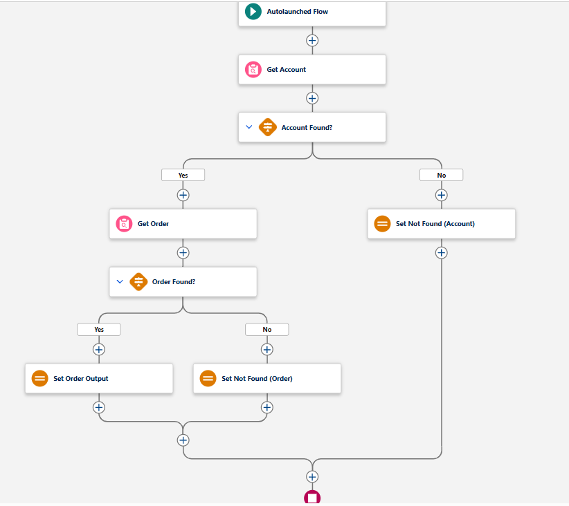
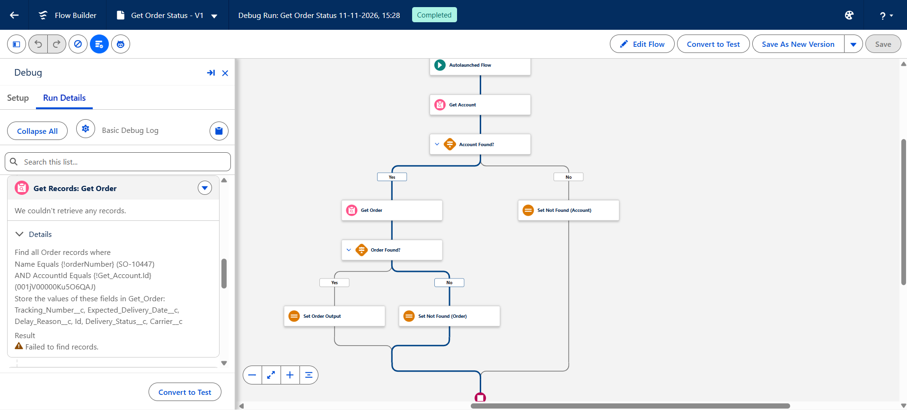
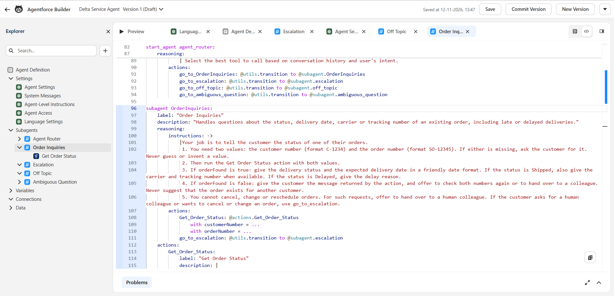
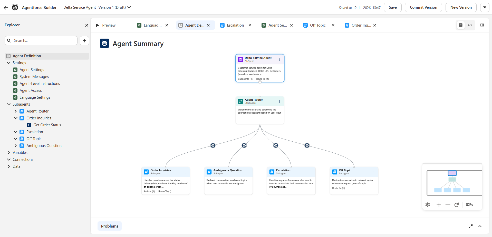
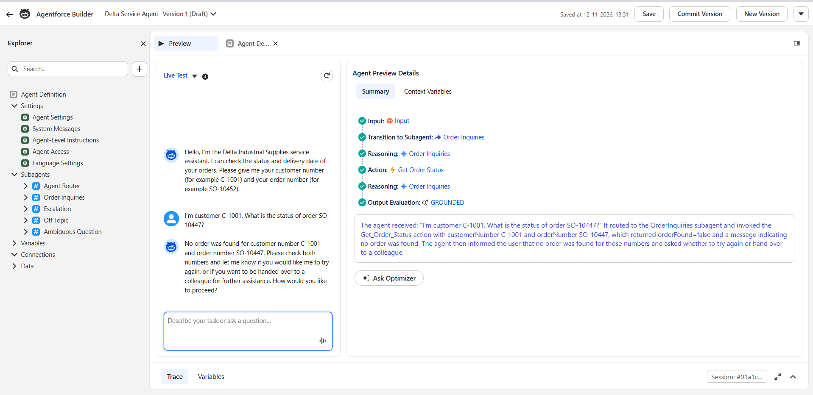

# Learning Log: B2B Service Agent on Salesforce

This log records every step of the project: what I did, what I learned, the problems I hit
and how I solved them, and how each step connects to the Forward Deployed Engineer (FDE)
role. At the end it becomes a printable PDF with interview questions.

---

## Step 1 (Day 1, 11 Nov 2026): Environment and project setup

### Goal
Prepare a professional working environment before building anything: a Salesforce org, the
tools on my computer, and a Git repository that holds the Salesforce configuration as code.

### What I did
1. **Created a free Salesforce Developer Edition org.** It came with Agentforce and Data Cloud
   features. Salesforce generated my username automatically (`...@agentforce.com`), which is
   different from my personal email.
2. **Created a public GitHub repo** `b2b-service-agent-salesforce`, empty (no README or
   .gitignore), so the first upload from my computer would not conflict.
3. **Installed the Salesforce CLI** (`sf`, version 2.157) and checked my tools:
   `sf --version`, `git --version` (2.55), `python --version` (3.12).
4. **Set up the project folder** with the base files of a Salesforce DX project:
   - `sfdx-project.json`: marks the folder as a Salesforce project and points to `force-app/`
   - `force-app/main/default/`: where all Salesforce metadata will live
   - `.forceignore`: files the CLI must never deploy
   - `.gitignore`: files Git must never upload (login tokens, secrets)
   - `README.md`: the front page of the repo
   - `CLAUDE.md`: project context for Claude Code (AI-assisted development)
5. **Connected the folder to my org** with the CLI:
   ```powershell
   sf org login web --alias delta-dev --set-default --instance-url https://<your-org>.develop.my.salesforce.com
   ```
6. **Made the first commit and pushed it to GitHub:**
   ```powershell
   git init
   git branch -M main
   git remote add origin https://github.com/mahdidadgar-data/b2b-service-agent-salesforce.git
   git add .
   git status
   git commit -m "Day 1: project setup - Salesforce DX project, README, project context"
   git push -u origin main
   ```
7. **Checked that Agentforce is available** in Setup: Agentforce Studio, Data Library,
   Registry (with Registered MCP Servers) and Gateway are all present.

### What I learned
- **Org:** a Salesforce org is one company's own Salesforce environment, with its own data,
  users and configuration. A Developer Edition org is a free one for learning and building.
- **Salesforce DX / "configuration as code":** professional teams don't only click things
  together in Setup. They keep the configuration (objects, fields, Flows, Apex, agents) as files
  in Git and deploy it with the CLI. That makes changes reviewable, repeatable and reversible.
- **Salesforce CLI (`sf`):** the command-line tool that connects my folder to an org. The
  **alias** (`delta-dev`) is a nickname, so every command goes to the right org.
- **OAuth login:** `sf org login web` opens a browser. I log in, Salesforce sends a code back to
  my computer (`localhost:1717`), and the CLI stores a secure token in `.sf/` and `.sfdx/`.
  These folders are secrets and must never go to GitHub.
- **Git basics:** `init` (start tracking), `remote add` (link to GitHub), `add` (choose files),
  `status` (check before committing), `commit` (save a snapshot), `push` (upload).
- **Check before you commit:** `git status` is the moment to catch secrets or wrong files.

### Problems I hit and how I solved them
| Problem | Cause | Solution |
|---|---|---|
| The installer kept reappearing after "Close" | The installer had been started several times | Installation was already complete. Cancelled the extra windows |
| Login in VS Code rejected my password | I used my email as the username. Salesforce had generated a different username (`...@agentforce.com`) | Found the real username under Settings and used it |
| Browser showed "localhost refused to connect" | The CLI command had timed out, so nothing was listening for the login code | Ran the login command again and finished it within the time window |
| Git warning "LF will be replaced by CRLF" | Windows and Linux end lines differently | Normal on Windows. Git handles it automatically |

### Link to the FDE role
An FDE starts every engagement by setting up a safe, reproducible environment: access to the
client's org, source control, and a clean way to deploy. Secrets are protected from the first
commit. This step is that foundation.

### Possible interview questions
- *Why keep Salesforce configuration in Git instead of only configuring in Setup?*
- *How do you make sure credentials and tokens never end up in a repository?*
- *What is a Salesforce org, and why would you work in a sandbox or developer org first?*

---

## Step 2 (Day 1, 11 Nov 2026): Discovery and the use-case brief

### Goal
Define *what* the agent should do, for whom, with which data, within which limits, and how
success is measured, before building anything.

### What I did
1. Logged in to **Trailhead** (Salesforce's free learning platform) with my Salesforce account
   and read the basics: Platform Basics, Data Modeling, Flow, Apex and Agentforce.
2. Wrote the **use-case brief** (`docs/use-case-brief.md`) for the fictional client Delta
   Industrial Supplies and agreed it as version 1.0.
3. Made two design decisions:
   - **Four use cases:** order status (resolve), product specs (resolve), quote request
     (prepare for sales), complaint/return (prepare for a human).
   - **Standard Salesforce `Order` object** instead of a custom object.

### What I learned
- **An FDE starts with the business problem, not the technology.** The brief is the first
  deliverable an FDE agrees with the client.
- **Choose use cases by volume and feasibility.** Order status is 35% of contacts and fully
  answerable from data, so it's the best first use case.
- **Three levels of agent work:**
  - *Resolve:* the agent finishes the request itself (order status, spec question).
  - *Prepare:* the agent collects information and creates a record for a human (quote → Opportunity, complaint → Case).
  - *Hand over:* the agent recognises it must not answer (safety advice, prices, legal).
- **Out of scope is as important as in scope.** Defining what an agent must *not* do is
  part of the design.
- **Guardrails in B2B:** the biggest risk is one customer seeing another company's data. Every
  lookup must be filtered by the customer's own Account.
- **Hallucination control:** the agent answers only from retrieved data. "I don't know" plus a
  hand-off is better than a confident wrong answer.
- **Success metrics before building:** accuracy on a test set (≥ 90%), correct hand-off on safety
  questions (100%), zero data leaks, containment rate, cost per conversation.
- **Standard vs custom objects:** Salesforce best practice is to use standard objects (Account,
  Order, Case, Opportunity) before creating custom ones. Standard objects bring built-in features,
  reports and integrations, and clients already know them.
- **An FDE always lists open questions for the client**, such as who signs off the guardrails
  and who maintains the datasheets.

### Link to the FDE role
The vacancy says the FDE works on site with client teams "to identify the use cases where agents
add the most value" and explains "results and trade-offs to client management in plain language".
The use-case brief is exactly that conversation, written down.

### Possible interview questions
- *How do you approach building and deploying an AI agent with a customer?*
  Start with the problem and contact mix → pick use cases → check data readiness → define
  guardrails and success metrics → build → test against an evaluation set → pilot → go-live →
  monitor.
- *How do you decide which use case to start with?*
- *What should an agent never do, and how do you enforce that?*
- *How would you prevent a customer from seeing another customer's data?*
- *How do you measure whether an agent is successful?*
- *Why did you choose the standard Order object instead of a custom object?*

---

## Step 3 (Day 1, 11 Nov 2026): Data foundation

### Goal
Give the agent realistic data to work with. Extend the standard Salesforce objects with the
fields the four use cases need, make those fields visible to users, generate synthetic data
in Python, and load it into the org in the right order.

### What I did
1. **Added custom fields to standard objects** (decision from the brief: standard objects
   before custom ones), kept as metadata in `force-app/main/default/objects/`:

   | Object | Field | Type | Used for |
   |---|---|---|---|
   | Account | `Customer_Number__c` | Text(20), unique, external ID | Stable customer key (e.g. `C-1001`) |
   | Account | `Customer_Segment__c` | Picklist: Installer, Contractor, Facility Management, Industrial | Segmentation |
   | Product2 | `Category__c` | Picklist: Pumps, Valves, Fittings, Insulation, Fixings | UC2 filtering |
   | Product2 | `Max_Pressure_bar__c` | Number(6,1) | UC2 spec answers |
   | Product2 | `Min_Temperature_C__c`, `Max_Temperature_C__c` | Number(5,0) | UC2 spec answers |
   | Product2 | `Connection_Size__c` | Text(30) | UC2 spec answers |
   | Product2 | `Material__c` | Text(60) | UC2 spec answers |
   | Product2 | `Datasheet_Text__c` | Long Text Area(32768) | UC2 grounding text (later: Data Library) |
   | Order | `Delivery_Status__c` | Picklist: Received, In Preparation, Shipped, Delivered, Delayed | UC1 status |
   | Order | `Expected_Delivery_Date__c` | Date | UC1 ETA |
   | Order | `Carrier__c`, `Tracking_Number__c` | Text(60), Text(40) | UC1 tracking |
   | Order | `Delay_Reason__c` | Text(255) | UC1 explanation for delays |
   | Case | `Related_Order__c` | Lookup(Order), set to null on delete | UC4 link to the order |
   | Case | `Created_By_Agent__c` | Picklist: Agentforce, Claude Agent, Human | Measuring agent vs human cases |
   | Opportunity | `Requested_Items__c` | Long Text Area(5000) | UC3 quote details |
   | Opportunity | `Delivery_Location__c` | Text(120) | UC3 quote details |
   | Opportunity | `Requested_Delivery_Date__c` | Date | UC3 quote details |

2. **Created the permission set `Delta_Data_Access`** with read and edit access to all 19
   custom fields, deployed it, and assigned it to my user:
   ```powershell
   sf project deploy start --source-dir force-app
   sf org assign permset --name Delta_Data_Access
   ```
3. **Wrote two separate scripts:**
   - `data/generate_data.py`: pure Python, no Salesforce connection. Writes JSON files to
     `data/generated/` (29 products, 12 accounts, 16 contacts, 40 orders with 91 order lines,
     4 cases, 3 opportunities). Fixed random seed, so the output is reproducible.
   - `data/load_data.py`: reads the JSON and loads it into the org through the Salesforce CLI
     (`data/sf_cli.py`). It refuses to run if Delta customers already exist, to avoid duplicates.
4. **Loaded the data in dependency order** (a record can only point to a record that already exists):
   1. Product2
   2. Activate the Standard Price Book, then one PricebookEntry per product
   3. Account
   4. Contact (needs AccountId)
   5. Order as *Draft* (needs AccountId and Pricebook2Id)
   6. OrderItem (needs OrderId and PricebookEntryId)
   7. Set Orders to *Activated* (an Order needs at least one product before it can be activated)
   8. Case (needs AccountId and `Related_Order__c`)
   9. Opportunity (needs AccountId)
5. **Verified in the org** with `sf data query`:

   | Object | Records |
   |---|---|
   | Product2 / PricebookEntry | 29 / 29 |
   | Account / Contact | 12 / 16 |
   | Order (all Activated) | 40: Delivered 14, Shipped 8, In Preparation 7, Received 6, Delayed 5 |
   | OrderItem | 91 |
   | Case / Opportunity | 4 / 3 |

### What I learned
- **Field-level security (FLS):** deploying a new field does not make it visible. Every field
  has read and edit permissions per profile or permission set, and until someone is granted
  them, the field is hidden from everyone, including the System Administrator in the UI and
  in API queries. A **permission set** is the clean way to grant that access: it is additive,
  lives in Git next to the fields, and can later be assigned to the agent's user too. That
  matters for the guardrails: the agent can only see what its permissions allow.
- **Standard Order rules:** an Order needs a Price Book, every Order Product needs a
  PricebookEntry, the Standard Price Book must be active, and an Order can only be activated
  once it has products. That is why the load runs in steps and activates at the end.
- **External ID:** `Customer_Number__c` is unique and an external ID. It is the stable
  business key the agent and the eval set use, instead of Salesforce record IDs, which change
  between orgs.
- **Generate vs load:** keeping generation separate from loading makes the data reviewable in
  Git, reproducible, and reusable as ground truth for the evaluation set (the eval script can
  compare the agent's answers with the JSON).
- **Picklists:** `Account.Type` is an unrestricted standard picklist, so the API accepts any
  value without complaining. The generator used `Customer`, which is not a value in this org,
  so I changed it to `Customer - Direct`. An unrestricted picklist does not protect data quality.
- **The sObject Collections API** (`/composite/sobjects`) inserts or updates up to 200 records
  per call. With `allOrNone: true`, a batch either fully succeeds or is fully rolled back, so a
  failed run never leaves half-loaded data behind.

### Problems I hit and how I solved them

**1. Two wrong hypotheses, tested one at a time.** The first loader used the Python library
`simple-salesforce` with the access token from `sf org display --json`. Every call was rejected
with `INVALID_AUTH_HEADER`.
- *Hypothesis A: the session expired* (about two hours had passed since login). Fix: make one
  call through the CLI first, so the CLI refreshes the token. Result: same error, so A was wrong.
- *Hypothesis B: the CLI hides the token unless `--verbose` is used.* Fix: add `--verbose` and a
  check that the token looks like a real session token. Result: same error, so B alone was not it.

After two guesses that did not change the result, I stopped guessing and measured.

**2. Token redaction, found with a diagnostic script.** `data/check_connection.py` checks
the connection step by step, without printing the token itself. It showed that the **CLI**
could query the org without problems, but the value it handed out as `accessToken` was not a
usable token: CLI 2.157 **redacts** the access token in its output, even with `--verbose`. So
the session was fine; Python simply never received a real token.

**3. Redesign: call the API through the CLI.** Instead of trying to extract the token (the
CLI hides it on purpose), `data/sf_cli.py` lets the CLI make every authenticated call:
`sf data query --json` for reads and `sf api request rest` against `/composite/sobjects` for
writes. The CLI keeps and refreshes the session; no token, password or secret ever passes
through Python. This is also the safer design.

**4. allOrNone hides the root cause.** The Product2 insert failed with 29 errors, and the
first five printed were all `ALL_OR_NONE_OPERATION_ROLLED_BACK`. That message only says
"this record was fine, but rolled back because another record failed". I changed `sf_cli.py`
to separate root-cause errors from rolled-back records and print the real ones first. Result:
**4 root-cause errors, 25 only rolled back.** The real error was `STRING_TOO_LONG` on
`Connection_Size__c`: four insulation products had values like
`Wall thickness 13 mm, for pipe 15-54 mm` (39–43 characters) in a Text(30) field.

**5. Fix the data, not the model.** I shortened the values in the generator
(`13 mm wall, pipe 15-54 mm`) instead of widening the field, because the field is a short spec
summary and the full wording stays in the datasheet text. Before loading again, I wrote a
**pre-flight check** that compares every value in the JSON with the org's own field
definitions (`sf sobject describe`: text length, picklist values, field exists). It found the
4 length errors plus the `Account.Type` problem in one run. After the fix: 0 problems, and the
full load succeeded the first time.

| Problem | Cause | Solution |
|---|---|---|
| API calls from Python rejected | CLI 2.157 redacts the access token, so Python had no real token (not an expired session) | Send every call through the CLI (`sf_cli.py`) |
| Only `ALL_OR_NONE_OPERATION_ROLLED_BACK` errors visible | With allOrNone, one bad record rolls back all the others | Print root-cause errors first |
| `STRING_TOO_LONG` on `Connection_Size__c` | 4 insulation values longer than Text(30) | Shortened the values in the generator |
| `Account.Type = 'Customer'` not a valid value | Unrestricted picklist accepts anything | Use the standard value `Customer - Direct` |

### Link to the FDE role
"The agent is only as good as the data" (brief, section 7). An FDE spends a large part of an
engagement on the data foundation: modelling, permissions, and getting clean data into the org.
Debugging in a client's org works the same way: form a hypothesis, test it with a small
diagnostic instead of guessing, and look for the root cause behind the noisy error. Security
constraints such as token redaction are not obstacles to work around; the design should respect
them.

### Possible interview questions
- *Why extend standard objects (Order, Case, Opportunity) instead of building custom objects?*
- *You deployed a new field but nobody can see it. What is the cause, and how do you fix it properly?*
- *Why use permission sets instead of editing profiles?*
- *In what order do you load related data into Salesforce, and why?*
- *Why separate data generation from data loading?*
- *A bulk insert returns hundreds of errors. How do you find the real one?*
- *Your first hypothesis about a bug was wrong. How did you find out, and what did you do next?*
- *How does your Python code authenticate to Salesforce without handling secrets?*
- *How do you validate data before loading it into a client's org?*
- *How will the agent's permissions limit what data it can see?*

---

## Step 4 (Day 1, 11 Nov 2026): First agent action - Get Order Status flow

### Goal
Build the first action the agent can call for UC1 (order and delivery status): given a
customer number and an order number, return the delivery details, but **only** if the order
belongs to that customer.

### What I did
1. **Built the flow by hand in Flow Builder** as an *Autolaunched Flow* (no trigger: it runs
   only when something calls it, such as an agent or an API).

   

2. **Tested it in Flow Builder's Debug mode** before activating it. The run below is the
   guardrail case: customer `C-1001` asks for order `SO-10447`, which belongs to `C-1004`.
   *Get Account* finds C-1001, but *Get Order* filters on `Name = SO-10447 AND AccountId =
   C-1001's Id` and finds nothing ("Failed to find records"), so the flow takes the *No* path
   to *Set Not Found (Order)*.

   

3. **Activated the flow and retrieved it into Git**, so the hand-built flow becomes reviewable
   source code:
   ```powershell
   sf project retrieve start --metadata Flow:Get_Order_Status
   ```
   Result: `force-app/main/default/flows/Get_Order_Status.flow-meta.xml`.
4. **Tested it through the REST API**, the same way an agent or integration calls it: the
   invocable-action endpoint, called through the CLI.
   ```powershell
   sf api request rest /services/data/v62.0/actions/custom/flow/Get_Order_Status --method POST --body "@tests/flows/get_order_status/a_own_order.json"
   ```
   The request bodies are in `tests/flows/get_order_status/`. `tests/run_flow_tests.py` runs
   all of them and checks the outputs (exit code 1 on failure):
   ```powershell
   .venv\Scripts\python.exe tests\run_flow_tests.py
   ```

### The flow design
**Inputs and outputs** (flow variables marked "Available for input/output"):

| Variable | Direction | Type | Meaning |
|---|---|---|---|
| `customerNumber` | input | Text | The customer, e.g. `C-1001` |
| `orderNumber` | input | Text | The order, e.g. `SO-10447` |
| `orderFound` | output | Boolean | True only if the order exists **and** belongs to this customer (default false) |
| `deliveryStatus` | output | Text | Received, In Preparation, Shipped, Delivered or Delayed |
| `expectedDeliveryDate` | output | Date | Expected delivery date |
| `carrier`, `trackingNumber` | output | Text | Only for shipped or delivered orders |
| `delayReason` | output | Text | Only for delayed orders |
| `message` | output | Text | The not-found message (empty when the order is found) |

**Logic:** *Get Account* (by `Customer_Number__c`) → *Account Found?* → *Get Order* (by
`Name` **and** `AccountId`) → *Order Found?* → *Set Order Output*, or one of the two
*Set Not Found* assignments. Both not-found assignments use the same constant,
`notFoundMessage`.

**How the XML is organised.** The retrieved file groups elements by type, not by the order
they run in:
- `<variables>`: the inputs and outputs above (`isInput` / `isOutput`), each with a description.
- `<constants>`: `notFoundMessage`, the one fixed message text.
- `<recordLookups>`: the two *Get Records* elements, with their `<filters>`.
- `<decisions>`: *Account Found?* and *Order Found?* (condition: the lookup result `IsNull = false`).
- `<assignments>`: *Set Order Output* and the two *Set Not Found* elements.
- `<start>` and each element's `<connector>`: the path through the flow.
- `<locationX/Y>` and `processMetadataValues`: canvas layout only, not logic.

### API test results

| Test | Input | Result |
|---|---|---|
| a) Own order | `C-1004` + `SO-10447` | `orderFound: true`, `deliveryStatus: Delayed`, `expectedDeliveryDate: 2026-11-18`, `delayReason: Carrier capacity problem in the region.` (matches `data/generated/orders.json`) |
| b) Other company's order | `C-1001` + `SO-10447` | `orderFound: false`, standard not-found message, no order details |
| c) Unknown customer | `C-9999` + `SO-10447` | `orderFound: false`, **the same** message, no order details |
| d) Empty customer number | `""` + `SO-10447` | `orderFound: false`, the same message, no order details |

All 5 checks pass: the 4 tests plus "b and c return an identical message".

### What I learned
- **Why a Flow for an agent action:** Flow is declarative. An admin can read, change and
  debug it in Flow Builder without writing code, which matters after the FDE has left.
  Agentforce can use an autolaunched flow directly as an agent action, and the input/output
  variables become the action's interface. I wrote a clear description on every variable,
  because the agent relies on those to decide what to pass in and how to read the result.
- **The account filter is a deterministic guardrail.** The rule "a customer only sees their
  own orders" is enforced in the query (`AccountId = the customer's account`), not in the
  prompt. Even if the model is tricked by a prompt injection, the action cannot return
  another company's order, because that data never reaches the model.
- **The same not-found message for every failure.** "Not your order", "unknown customer" and
  "order does not exist" all return exactly the same text. If the messages differed, someone
  could probe which customer numbers or order numbers exist (an information leak, also called
  enumeration).
- **Outputs are explicit.** Only the fields copied in *Set Order Output* leave the flow. Price,
  account details and order lines are never returned, so the agent can't leak them either.
- **Debug mode first, then activate.** Flow Builder's Debug shows each element's query, the
  values it used, and the path taken. That makes it quick to check the guardrail visually
  before anything goes live.
- **Build in the UI, keep in Git.** Building a flow by hand is fine. Retrieving it to source
  afterwards makes it versioned, reviewable and deployable to another org like any other code.
- **Test through the real interface.** Testing through the invocable-action REST endpoint
  checks exactly what the agent will receive, including how values are formatted: the Date
  comes back as `2026-11-18T00:00:00.000+0000`.

### Problems I hit and limitations
| Issue | Detail | Solution / next step |
|---|---|---|
| Output name | I expected an output called `notFoundMessage`, but that is the *constant*. The output variable is `message`, which receives the constant's text | Tests check `message`. Constants are never outputs |
| **Order Name is not unique** | `Order.Name` is a free-text field. Two orders with the same name in one account would make *Get Order* (first record only) return an arbitrary one. It is unique in my data only because the generator makes it so | For production: a unique external-ID order number field, or a duplicate rule on Order Name |
| Empty customer number | A *Get Records* filter "equals {!customerNumber}" with an empty value matches records where the field is empty. It returns "not found" today only because **every** Account in this org has a customer number | Added test d) as a regression check. **Fixed in version 2** (see *Hardening (v2)* below) |
| Where the customer number comes from | The flow trusts its `customerNumber` input. If the agent took that number from the chat, a user could type another company's number | Documented limitation, to be solved in Step 5 (agent configuration): take the account from the logged-in portal user (Contact → Account), never from user input |

### Hardening (v2)
**Why test d) existed.** In version 1, an empty customer number went straight into *Get
Account*, whose filter then became "`Customer_Number__c` equals empty". That matches **any**
Account without a customer number. The flow returned "not found" only because every Account in
this org happens to have a customer number. That is **safe by data, not safe by design**: the
guardrail would break without any warning the day someone adds an Account without a number
(a prospect, a sample record, a data migration). Anyone who sent a blank customer number
could then see that account's orders. A blank order number had a similar weak spot inside an
account.

**The fix.** Version 2 adds a first decision, *Inputs Provided?*, right after Start. It
continues only if `customerNumber` **and** `orderNumber` are both not blank (`IsBlank` covers
empty, null and whitespace). Otherwise it goes to *Set Not Found (Blank Input)*, which returns
the same not-found message as the other two paths. The decision **fails closed**: only the
explicit "Yes" path continues, and everything else ends in "not found".

**Made as code, deployed as version 2.** I edited the flow XML in Git and reviewed the diff
(1 new decision, 1 new assignment, the Start connector moved). Then I deployed:
```powershell
sf project deploy start --source-dir force-app/main/default/flows
```
Salesforce saved the change as **version 2 and made it active**. Version 1 is kept as
*Obsolete*, so it is still available for a rollback. I re-ran the API tests (all pass), then
retrieved the flow again and confirmed the retrieved file was identical to my edit, so Git
matches the org exactly. Two caveats:
- **Black-box tests can't see the path.** Test d) passed in v1 *and* v2, because the output is
  the same by design. What changed is the reason: v2 stops at the guard and no longer depends
  on the data. Flow Builder's Debug mode shows which path the flow took.
- **Developer org vs production.** In this Developer org the flow deployed straight as active.
  In a client's production org, settings can make deployed flows inactive or require test
  coverage, so check that before a client deployment.

### Link to the FDE role
Agent actions are where an FDE turns business rules into safe, testable building blocks. The
key judgement is **what to enforce deterministically** (data access, in the action) and **what
to leave to the model** (the conversation). Building in a tool the client's admins know (Flow),
keeping it in Git, and proving the guardrail with automated API tests is the kind of evidence a
client's security and architecture reviewers ask for.

### Possible interview questions
- *Why did you build this action as a Flow and not in Apex? When would you choose Apex instead?*
- *How do you make sure an agent cannot show one customer another customer's data?*
- *Why enforce the guardrail in the action instead of in the agent's instructions?*
- *Why does the action return the same message for "not your order" and "unknown customer"?*
- *Where should the customer's identity come from in production, and why not from the chat?*
- *How do you test an agent action before connecting it to the agent?*
- *The flow was built in the UI. How do you get it under version control and into another org?*
- *What are the limitations of looking up an order by its name?*
- *What would you check in a code review of an agent action?*
- *Your guardrail test passed. How do you know it passed for the right reason? ("safe by data" vs "safe by design")*
- *How do you change a flow that is already live, and how would you roll it back?*

---

## Step 5 (Day 2, 12 Nov 2026): Agentforce agent

### Goal
Turn the Get Order Status flow into a working conversational agent for UC1: an Agentforce
Service Agent that understands an order question, collects the customer number and the order
number, calls the flow, answers in the customer's language, and hands over to a human when the
request is out of scope. Then get the agent into Git, like the flow and the data model.

### What I did
1. **Built "Delta Service Agent" (`Delta_Service_Agent`) in the new Agentforce Builder**, which
   uses **Agent Script**: the whole agent is one readable script (system instructions,
   settings, subagents, actions and transitions), with a canvas and an editor on top of it.
2. **Started from the Agentforce Service Agent template and scoped it down** to what the
   use-case brief allows for this step:
   - **Kept 5 subagents:** Agent Router (the start node that picks a subagent), Order
     Inquiries, Escalation, Off Topic and Ambiguous Question.
   - **Removed 6 subagents and 5 template actions**, including **Cancel Order** (the brief says
     the agent never changes or cancels orders) and **Get Order By Order Number**, which looks up
     an order by number alone, without the customer filter that is the whole point of our flow.
3. **Added our flow as the action Get Order Status** in Order Inquiries
   (`target: "flow://Get_Order_Status"`):
   - both inputs (`customerNumber`, `orderNumber`) marked **required**;
   - **descriptions written as prompts**: the action, every input and every output tell the
     model what the value means, its format, and what not to do ("Always ask the user for it.
     Never guess it.");
   - **loading text** "Checking your order status…", shown while the action runs.
4. **Wrote the Order Inquiries instructions** as numbered steps: collect both numbers, run the
   action, answer from `orderFound`, use the action's own not-found message, never suggest the
   order exists for another customer, and escalate for cancel or change requests.

   

5. **Assigned the permission set `Delta_Data_Access` to the agent user**, the dedicated user
   that the agent's actions run as.
6. **Added Dutch to Allowed Languages** (Language Settings), next to English.
7. **Tested in the builder's Preview** (results below) and committed the agent as **Version 1**.

   

8. **Retrieved the agent into Git.** I did not guess which metadata types hold an Agent Script
   agent. I listed them from the org first:
   ```powershell
   sf org list metadata-types --target-org delta-dev
   sf org list metadata --metadata-type AiAuthoringBundle --target-org delta-dev
   ```
   and repeated the second command for each candidate type. Result:

   | Metadata type | Component | What it holds |
   |---|---|---|
   | `AiAuthoringBundle` | `Delta_Service_Agent_1` | The **Agent Script source** as edited in the builder (`.agent`), plus a bundle file that points to `Delta_Service_Agent.v1` |
   | `Bot` (with `BotVersion` `v1`) | `Delta_Service_Agent` | The agent record and its version: agent user, messages, settings |
   | `GenAiPlannerBundle` | `Delta_Service_Agent_v1` | The planner for version 1: the compiled script, the agent graph and the input/output schema of each action |
   | `AiAgentDefinition` (+ `AiAgentDefinitionVersion` `#1`) | `Delta_Service_Agent` | The newer agent-definition types, with the same script, graph and schemas |
   | `GenAiPlugin`, `GenAiFunction` | none | The legacy builder stored topics and actions here. With Agent Script they live inside the script, so these lists are empty |

   The bundle, bot, planner and agent definition were all modified within four seconds of each
   other (12:59:37–12:59:41), the moment I clicked **Commit Version**. The authoring bundle is
   the source I edit; the others are what the org generates from it.
   ```powershell
   sf project retrieve start --metadata "AiAuthoringBundle:Delta_Service_Agent_1" --metadata "Bot:Delta_Service_Agent" --metadata "GenAiPlannerBundle:Delta_Service_Agent_v1" --metadata "AiAgentDefinition:Delta_Service_Agent" --metadata "AiAgentDefinitionVersion:Delta_Service_Agent#1" --target-org delta-dev
   ```
   This added 15 files under `force-app/main/default/` (`aiAuthoringBundles/`, `bots/`,
   `genAiPlannerBundles/`, `aiAgents/`, `aiAgentDefinitionVersions/`).
9. **Checked the retrieved files for secrets before committing.** No tokens, session IDs,
   passwords, org URL or personal email. One catch: the generated `.agent` and graph files are
   **base64-encoded**, so a plain-text search cannot see inside them. I decoded every base64
   block and scanned the decoded text as well. It is clean, and the decoded script is identical
   to the authoring script. The only org-specific value is the agent user's username
   (`delta_service_agent@00d….ext`, which contains the org ID). It is not a secret, and the
   metadata needs it to deploy.

### Why the new builder (Agent Script)
- **Legacy agents are on their way out.** Agents built in the legacy builder (on GPT-4o) are
  deprecated. A new agent should not start on a platform that is already being retired.
- **The model is not permanent either.** The model behind the new builder is also on a
  retirement path. Every model change can change routing and answers without a single line of
  my configuration changing. The protection against that is not the builder, it is the **test
  set** (Step 8): run the same questions before and after a model change and compare.
- **Agent Script is reviewable.** One script holds the instructions, the routing and the action
  contracts, so a change shows up as a readable diff in Git, like the flow XML in Step 4.

### Preview test results
Run in the builder's Preview, with the trace open for every message.

| # | Test | Input | Expected | Result |
|---|---|---|---|---|
| 1 | Own order | `C-1004` + `SO-10447` | Delayed, 18 Nov 2026 (per `orders.json`) | ✅ Delayed, 18 Nov 2026, correct |
| 2 | Guardrail: other company's order | `C-1001` + `SO-10447` | Not found, no details | ✅ Standard not-found message, nothing about the order leaked |
| 3 | Missing customer number | Order number only | Agent asks for the customer number | ✅ Agent asked for the customer number |
| 4 | Cancel request | A request to cancel an order | No cancellation, hand-over | ✅ Routed to Escalation, nothing cancelled (there is no cancel action) |
| 5 | Dutch, then a human | `C-1011` + `SO-10462` in Dutch, then "ik wil een medewerker" | Answer in Dutch (per `orders.json`: Shipped, DB Schenker, with tracking number), then escalate | ✅ Correct answer in Dutch, then `escalate_to_human` |
| 6 | Off topic | A general-knowledge question | Politely declined | ✅ Declined and redirected to order questions |



### What I learned
- **A template is a starting point, not a design.** The Service Agent template brings many
  subagents, actions and hidden conditions. Scoping it down to the brief is a security task:
  every action left in is something the model can call. Cancel Order and an unfiltered order
  lookup had to go.
- **Descriptions are prompts.** The model chooses actions and fills inputs from the names and
  descriptions only. "Required" plus "Always ask the user for it. Never guess it." is what made
  test 3 pass.
- **The router decides with the transitions it can see.** A subagent is only reachable through a
  transition action, and a condition on that transition can hide it completely.
- **Two places called `actions:`.** In Agent Script, `reasoning.actions` lists the tools the
  model may use in that subagent (including transitions). The subagent-level `actions` block
  *defines* actions (target, inputs, outputs). Mixing them up breaks the script.
- **The trace is the debugger.** It shows every step: input, transition, reasoning, action,
  output evaluation (for example `GROUNDED`). Each bug below was found by reading the trace, not
  by rewording prompts at random.
- **Test as the runtime user.** Admin tests prove the logic. Only a test as the agent user proves
  the permissions.
- **Guardrails stay in the action.** Removing the template's verification condition did not
  weaken security, because the customer filter lives in the flow (Step 4), not in the
  conversation.
- **Generated metadata can hide content.** Base64 blocks in retrieved files must be decoded
  before a secret scan means anything.

### Problems I hit and how I solved them

**1. Order question routed to Off Topic.**
- *Symptom:* an order-status question got the Off Topic redirect.
- *Trace:* the Agent Router transitioned to Off Topic; the transition to Order Inquiries was not
  available to it.
- *Root cause:* a leftover template condition on the transition, `available when
  @variables.isVerified == True`. The template expects an e-mail verification step that sets
  `isVerified`. I had removed that step, so `isVerified` stayed `False` and the router could
  never see Order Inquiries.
- *Fix:* removed the condition. The guardrail is not lost: the flow only returns orders of the
  given customer.
- *Lesson:* when you remove part of a template, look for everything that depended on it.

**2. The action ran, but the flow failed with `INVALID_TYPE`.**
- *Symptom:* the agent could not give the order status.
- *Trace:* the Get Order Status action was called with the right inputs, and the flow returned
  `INVALID_TYPE`.
- *Root cause:* `Delta_Data_Access` had only field permissions, no object permissions. The agent
  user could not read Account or Order at all, so the flow's lookups failed. My flow tests in
  Step 4 passed because they ran as the admin, who has access to everything.
- *Fix:* read-only object access on Account and Order (create, edit, delete, View All and
  Modify All all false), deployed from Git and verified with a query on `ObjectPermissions`
  (commit `4e87038`). Case, Opportunity and Product2 follow in Step 6 when an action needs them.
- *Lesson:* test as the runtime user, and grant the least privilege that makes the test pass.

**3. "Connect me with a human" stayed in Off Topic.**
- *Symptom:* once the conversation was in Off Topic, "connect me with a human" got another Off
  Topic redirect instead of a hand-over.
- *Trace:* the message stayed in Off Topic, and no transition was called.
- *Root cause:* the template's Off Topic subagent has no actions, so once the conversation is
  there it has no way out.
- *Considered:* the setting **Reset to Initial Node**. It resets per session, not per message,
  so it would not have helped.
- *Fix:* explicit transitions. Off Topic got `go_to_escalation` and `go_to_OrderInquiries`, and
  Order Inquiries got `go_to_escalation` (for "talk to a human", cancel and change requests).
  My first attempt put the transition line in the subagent's action-definition block instead
  of `reasoning.actions`, and the Problems panel showed 28 problems. I moved it before saving.
- *Lesson:* design the exits of every subagent, not only the entrances, and read the Problems
  panel before saving.

**4. A Dutch question got an English answer.**
- *Symptom:* a question in Dutch got an answer in English.
- *Trace:* routing and the action were correct; only the response language was wrong. So it was
  configuration, not reasoning.
- *Root cause:* only English was in Allowed Languages, so the instruction "answer in the
  customer's language" could not take effect.
- *Fix:* added Dutch to Allowed Languages. I did not use the beta Adaptive Language Mode: a
  fixed list of languages is predictable and testable, and a client would not want a beta
  feature in production.
- *Lesson:* some behaviour is set by configuration, not by the prompt. Check settings before
  rewriting instructions.

| Problem | Cause | Solution |
|---|---|---|
| Order question went to Off Topic | Leftover `available when @variables.isVerified == True` on the transition | Removed the condition; guardrail stays in the flow |
| Flow failed with `INVALID_TYPE` | Permission set had no object permissions; tests ran as admin | Read-only object access on Account and Order (`4e87038`) |
| Stuck in Off Topic | Off Topic had no transitions out | `go_to_escalation` / `go_to_OrderInquiries` in Off Topic, `go_to_escalation` in Order Inquiries |
| English answer to a Dutch question | Dutch not in Allowed Languages | Added Dutch (not the beta Adaptive Language Mode) |

### Open items for Step 8
| Item | Detail |
|---|---|
| Welcome message is static English | Dutch customers are greeted in English. Options: a bilingual welcome, or a welcome based on `EndUserLanguage` once a real channel is connected |
| Ambiguous Question has no exits | Like Off Topic before the fix, it has no transitions, so a conversation can get stuck there |
| Escalation goes nowhere real | `escalate_to_human` works in Preview, but real routing to a human needs Omni-Channel and a messaging channel, which this Developer org does not have set up |
| Identity comes from the chat | The customer number is typed by the user. The flow guarantees one customer never sees another's orders *for that number*, but anyone who knows a customer number and an order number can ask. In production the customer must come from the logged-in portal user (User → Contact → Account), never from the conversation |

### Link to the FDE role
This step is the core of FDE work: take a vendor template, cut it down to the client's use case,
connect it to the client's own business logic, and prove it works with the client's real users
and permissions. Most of the time went into debugging routing, permissions and configuration,
not into writing prompts. Reading the trace and finding the root cause is what an FDE does on
site when an agent "does something strange" in front of the client.

### Possible interview questions
- *How did you build the agent, and why did you start from a template?*
  From the Agentforce Service Agent template, because it brings tested routing, escalation and
  off-topic handling. Then I removed everything outside the brief, including Cancel Order and an
  order lookup without a customer filter, because every action left in is something the model
  can call.
- *Your agent called the action, but it failed. How did you find out why?*
  The trace showed the action ran with the right inputs and the flow returned `INVALID_TYPE`. The
  agent user had field permissions but no object read on Account and Order. My tests had passed
  because they ran as admin. Fixed with least-privilege read access, and the lesson is to test
  as the runtime user.
- *How do you stop the agent from showing one customer another customer's order?*
  In the action, not in the prompt: the flow filters the order by the customer's account and
  returns the same not-found message for every failure. Test 2 in Preview confirms that nothing
  leaks. The remaining gap is identity: in production the customer must come from the logged-in
  user, not from the chat.
- *The model behind Agentforce will change. How do you protect the client?*
  With a regression test set: the same questions, expected outcomes and guardrail cases, run
  before and after every model or configuration change. That is Step 8. The builder or the
  prompt does not protect you; measurement does.
- *What is the difference between a topic or subagent and an action?*
  A subagent is a job with its own instructions (Order Inquiries). An action is a tool it can
  call (the flow) or a transition to another subagent. The router only sees the transitions it
  is given, so routing problems are often missing or blocked transitions.
- *A customer asks for a human and the agent ignores it. What do you check?*
  The trace: which subagent the conversation is in, and whether that subagent has a transition
  to Escalation. In my case Off Topic had none, so I added explicit transitions. In production
  you also need Omni-Channel behind `escalate_to_human`.
- *How do you keep an agent built in a UI under version control?*
  List the metadata types in the org instead of guessing, retrieve them with the CLI, check the
  files for secrets (including base64 content) and commit. For Agent Script the authoring bundle
  is the source; the bot and planner metadata are generated from it.
- *Why didn't you use the beta Adaptive Language Mode?*
  A fixed list of allowed languages is predictable and can be tested. Beta features change
  without notice, which is not what a client wants in production.

---

<!-- Next steps are added as the project continues. -->
